# 从零读懂电子密度论文：前置知识详解

这套材料服务于一个具体目标：读懂阅读人2的9篇论文，并能解释每篇的输入、输出、方法和实验到底在做什么。补充的4篇来自之前的阶段汇报。它不要求你一开始就会量子化学、群论或深度学习。

**阅读规则：先理解一句话，再看例子，最后回到公式。** 公式不是必须背诵的口令，而是把一句话写得更准确的方法。第一遍可以跳过“进一步理解”，但不要跳过每节的“检查自己”。材料中的生活类比只帮助建立直觉；标有“教学实验”的计算不属于论文复现。

## 这次具体增加了什么

前置知识分为28节，每节都有解释、例子和检查题。9篇主论文保留模型、年份、输入、编码、数据集、代码、下游任务等信息，再加逐步讲解、公式读法、结果和局限；补充4篇单独标明。正文包括5张教学计算/原理图，以及8张带PDF页序的原文页面。

推荐先点“前置知识”，按编号读；读到相关论文时，可从论文标题下的“先补这些章节”返回。页面有关键词搜索、字号调整、学习标记和可展开答案。所有核心内容与图解可离线使用。原文/软件外链需要联网；原文PDF跳转需保留项目目录。

证据用语约定：“论文中已实验评估”表示作者做过计算或湿实验，具体会注明；“教学实算”表示本机新运行的小计算；“潜在用途/教学建议”不冒称已验证。没有宣称本机重现任何论文主表。

## 三个最容易卡住的地方

第一，坐标、轨道、密度和密度矩阵不是同一种东西，分别看第02、06、09、10节。第二，SCF、几何优化、神经网络训练是三个循环，分别看第07、11、21节。第三，密度预测、泛函学习、性质预测与分子生成是不同任务，后面的比较表会逐一对齐。

## 01 先知道整个方向在做什么

一个分子可以分成两层信息：原子核的骨架，以及骨架周围的电子分布。XYZ坐标主要告诉你骨架在哪里；电子密度告诉你电子怎样分布。改变键长、靠近另一个分子、变成离子，电子分布通常都会变化。

电子分布影响静电作用、成键和许多性质，但计算它需要时间。因此这批论文在回答不同的问题：能不能从骨架快速预测密度？能不能利用密度改善能量计算？能不能把密度变成机器学习特征？能不能先生成适合口袋的密度，再搭出分子？

把整件事画成一条路：**元素与坐标 → 电子结构求解 → 密度与轨道 → 性质、能量或分子设计**。机器学习可以替代其中一步，也可以在某一步加入辅助信息。不能把所有文章都理解成“AI预测电子密度”。

举例：ELECTRA输入已有分子的结构，输出密度；EG-XC在DFT计算里面改进交换关联能；VisionED把已得到的电子结构做成图片，再预测材料性质；L11先看蛋白口袋，再生成新的分子。四者中的“电子密度”扮演不同角色。

**检查自己：** 看到标题里有electron density，你能否先问“它是输入、输出，还是中间变量”？如果暂时答不出，先找论文流程图和Methods中的数据定义。

## 02 原子、分子、构象和蛋白口袋

原子序数Z是核中质子数，也决定元素身份。中性水含一个氧和两个氢，核电荷总和为8+1+1=10，所以有10个电子。一般电子数N = ΣZ_A − Q，Q以正电荷为正，例如失去一个电子的正一价体系Q=+1。

分子结构不是一张二维连线图。原子在三维空间的排布也重要。**构象**通常指连接关系相同、三维姿态不同的结构，比如绕单键旋转。一个分子可以产生很多构象，因此“100万个构象”不等于“100万种化合物”。

蛋白质由氨基酸残基组成，口袋是可能容纳配体的一片三维区域。配体是与蛋白相互作用的分子。口袋不是刚性模具：蛋白和配体都可运动，水、离子、质子化状态也可能改变作用。

XYZ常保存元素和坐标，不一定显式保存键、电荷或多重度。PDB/mmCIF主要保存结构模型及相关元数据。单独拿到坐标文件，不等于同时拿到了实验密度图或波函数。读取文件时先确认其内容，而不要只看后缀。

**检查自己：** 同一个药物有500个构象，数据规模该怎样写？答：1种分子、500个几何结构；如果每个几何上又取10万个密度采样点，那是500个场上的采样，不是5000万种独立分子。

## 03 看论文之前补的数学：坐标、函数与场

一个点的位置写作r=(x,y,z)。原子A的位置写作R_A。二者不要混淆：R_A通常是固定的一组核坐标；r可以是你任意选择的空间查询位置，比如某个键中间。

函数是“给一个输入，返回一个结果”的规则。f(x)=x²输入2得到4。电子密度ρ(r)输入一个三维坐标，返回一个密度数值，因此是**三维标量场**。标量场有空间变化，但每个位置只返回一个数；电场则在每个位置返回一个带方向的向量。

举例：给水分子的模型查询r=(0,0,0.1)，模型返回一个密度；换到远离分子的位置，值通常很小。查询点不是新增原子，也不改变原有结构。eqDeepDFT和GPWNO中的query points就有这个作用。

向量可以表示位置、位移或力，但“有3个分量”不自动说明它是哪一种。张量是更广泛的多分量对象，例如3×3矩阵也可以按特定旋转规则变化。论文说Cartesian tensor，关键在于各分量在坐标旋转时怎样一起变换。

**检查自己：** 原子坐标数组(N_atoms,3)和密度数组(N_query,1)分别是什么？前者描述骨架，后者描述若干位置上的场值；还需要(N_query,3)的查询坐标才能知道每个密度值对应哪里。

## 04 积分：密度为什么不等于电子个数

密度是单位体积里的电子数，不能把某点的密度直接读作“这个点有几个电子”。类比人口密度100人/平方公里，并不是说某一个点上站着100个人。对一块区域积分，才得到区域内的电子数期望值。

关键公式：**∫ρ(r)d³r = N**。读作“把整个空间每一小块中的电子数加起来，总共得到N”。ρ(r)可以写成电子/bohr³或电子/ų，体积元d³r提供体积单位，两者相乘才得到电子数。

规则网格上，积分可近似成Σρ_i ΔV。假设每格体积0.01 ų、格内平均密度2电子/ų，这格贡献约0.02个电子。这里的0.02是区域内电子数的期望值，并非把电子切开。更细网格和更大空间范围通常能减小积分误差。

1 bohr约为0.529177 Å。由于体积按长度的三次方变化，1电子/bohr³约为6.7483电子/ų。**只把坐标从bohr换成Å，而不变换密度数值，会算错积分。** 文件值是否已经乘了晶胞体积，也要读格式说明。

**检查自己：** 中性水的密度积分得到9.2，可能是什么原因？先查网格范围、步长、单位、是否只含价电子、赝势/PAW密度定义，以及模型是否守恒。不能立即断言水“只有9.2个电子”。

## 05 导数、梯度、拉普拉斯与力

导数描述“稍微改变输入，输出会怎么变”。一维曲线越陡，导数绝对值越大。三维密度的梯度∇ρ有三个分量，指向密度增加最快的方向。拉普拉斯∇²ρ是三个坐标方向二阶导数之和，用于描述局部空间变化的弯曲性质。

如果把ρ当成地形高度，梯度类似最陡的上坡方向；在临界点梯度为零，但临界点可以是峰、谷或鞍点，需要进一步看Hessian。Hessian是把各方向的二阶导数排成的矩阵，帮助判断不同方向怎样弯曲：鞍点就像一个方向往上、另一个方向往下的山口。这个类比说明数学分类，不代表电子密度真的有一张二维地形。

另一个非常重要的导数是**F_A = −∂E/∂R_A**：原子A的力来自能量对核位置的负梯度。体系倾向沿让能量下降的方向移动。因此，能量预测得接近并不保证力也准确：一条曲线的高度可以接近，局部斜率仍可能错。

这解释了∇²DFT为什么同时提供能量和力，也解释了几何优化为何是比单点能量测试更实际的检验。若每一步力都稍有偏差，连续优化或动力学的误差会累积。自动微分能计算模型的导数，但不能保证这个导数接近真实物理。

**检查自己：** 若能量误差很小，是否必定能用于稳定的分子动力学？答：还需检查力、平滑性、守恒、长时间稳定性和分布外结构。

## 06 波函数：为什么比一朵电子云复杂

波函数Ψ描述量子态。单电子的空间波函数ψ(r)可以取正、负或复数。按玻恩规则，|ψ(r)|²d³r与在这块小体积内找到该电子的概率有关；含自旋时还要把自旋情况计入。波函数的符号或相位影响干涉，并不是正电荷与负电荷的颜色。

多电子波函数Ψ(x₁,…,x_N)依赖所有电子的联合配置，其中x包含位置和自旋。对10个电子，仅空间坐标就有30个连续变量，所以它不能简单画成三维空间的一团云。普通三维图展示的通常是一个轨道、密度切片或等值面。

密度由波函数消去其他电子变量得到：**ρ(r)=NΣ自旋∫|Ψ(r,σ₁,x₂,…,x_N)|²dx₂…dx_N**。直观地说，只关心“这里平均有多少电子”，把其他电子所有可能位置加总掉。

密度因此比完整波函数简单，但也不显式保存所有关联信息。两个对象在数据规模和物理含义上差别很大。“预测到密度”不能自动解释成“恢复了全部轨道或多电子波函数”。

**检查自己：** 一张轨道图中红蓝两色通常表示什么？常是波函数正负相位；先看图例，不能把它直接当成电子富集与贫乏。密度|ψ|²本身非负。

## 07 薛定谔方程、算符和玻恩–奥本海默近似

定态薛定谔方程写作**ĤΨ=EΨ**。Ĥ是哈密顿算符，表示总能量怎样作用于波函数；满足方程的Ψ是能量本征态，E是对应能量。算符是一种对函数进行操作的规则，比如求导，不只是一个普通数。

固定核、非相对论电子哈密顿量通常包括：电子动能、电子受原子核吸引、电子相互排斥。原子核之间也有排斥能，在固定几何时它是常数。软件报告的分子总能量通常包含核间排斥，比较时要确认口径。

困难主要来自电子相互作用：一个电子受到其他电子分布影响，而其他电子也受到它的影响。电子不是互不相干的小球，直接求解完整联合波函数很贵。这是HF、DFT及半经验近似存在的原因。

玻恩–奥本海默近似利用核通常比电子重很多这一点，先在固定核位置上求电子态，再把电子能量与核间排斥组成势能面E(R)。原子核之后可以沿这个面移动。它不是“核永远不动”，在非绝热耦合强或能面接近时也可能失效。

**检查自己：** “单点计算”和“几何优化”差在哪里？单点固定R求电子结构和能量；优化重复改变R，寻找能量的局部低点。SCF循环与几何优化循环是内外两层循环。

## 08 费米子、斯莱特行列式、交换与相关

电子属于费米子。交换两个电子的全部坐标与自旋后，多电子波函数要改变符号，这叫反对称性。斯莱特行列式把一组自旋轨道组织成满足反对称性的波函数，也自动体现泡利不相容原理。

直觉例子：不能把两个电子放进完全相同的自旋轨道。一个空间轨道可以容纳两个自旋相反的电子，因此中性水的闭壳层描述有5个双占据空间轨道。这里的轨道是一种量子状态，不是电子绕核的行驶轨迹。

**交换作用**来自反对称性，尤其改变同自旋电子的联合分布。**电子相关**在量子化学的常用定义中，指超出HF单行列式平均场描述的效应。不能把“交换”理解成电子碰面后互换位置，也不能把“相关”理解成统计图上两条线一起升降那么简单。

HF包含交换，但没有完整的动态电子相关。两个电子会相互避开，平均场只记录平均影响，难以捕捉所有即时联动。近简并或断键时，多行列式性质可能重要，这类静态/强相关又给简单方法增加困难。

**检查自己：** HF是否忽略全部电子相互作用？不是。它有平均库仑排斥和交换；缺失的是更完整的相关描述。

## 09 原子轨道、分子轨道和高斯基组

分子轨道常展开为**ψ_i(r)=Σ_μ C_μi χ_μ(r)**。χ_μ是预先选定的基函数，C_μi是待求系数。类比用积木拼形状：积木形状和数量由基组规定，系数决定每块用多少。

原子中心高斯函数大致包含“局部坐标的多项式×exp(−α|r−R_A|²)”。α大时更集中，α小时更弥散。高斯基的积分容易高效计算；多个高斯常收缩成一个基函数以兼顾成本与表达力。化学中的s、p、d等壳层表达不同角向形状。

最小基组像每种基本状态只备少量积木，较便宜但灵活性有限；双ζ、三ζ增加径向变化能力。**极化函数**允许分布向非球形方向变形；**弥散函数**补充较远处的长尾，对阴离子或弱束缚电子尤其可能重要。

要分清三种“基”：求分子轨道的AO基组、拟合密度的辅助基组、机器学习用来输出场的表示基。L25用cc-pVQZ生成参考电子结构，又用cc-pVQZ/JKFIT展开密度；两者任务不同。ELECTRA中的floating orbitals也不能直接当作算出来的占据分子轨道。

**检查自己：** 两种基组算出不同能量，是否说明电子数变了？没有。相同电荷下电子数相同，是表达能力与数值近似变了。下面的实算会用7个和24个AO基函数描述同一10电子水分子。

## 10 密度矩阵、重叠矩阵和Fock矩阵

在闭壳层实轨道的常见约定中，密度矩阵P_μν=2Σ占据i C_μi C_νi。空间密度由**ρ(r)=Σ_μν P_μν χ_μ(r)χ_ν(r)**重建。P是基底下的矩阵，ρ是空间中的函数，不是同一种数据对象。

AO基函数通常不互相正交，重叠矩阵S_μν=∫χ_μ(r)χ_ν(r)d³r记录它们的重叠程度。因此电子数是**Tr(PS)=N**，通常不是简单地把P对角线相加。矩阵形状为(基函数数,基函数数)，并不等于(原子数,原子数)。

HF或KS计算常求广义本征值问题**FC=SCε**。F是Fock/有效单电子矩阵，C给出轨道展开系数，ε是轨道能量。因为F又依赖当前电子分布，需要自洽求解。

∇²DFT提供这些矩阵，是希望模型学习更丰富的电子结构信息。预测F并不意味着已经得到总能量，也不意味着可以忽略S和轨道占据。不同元素的AO数目可能不同，矩阵预测模型还要处理旋转时基函数的变化。

**检查自己：** 论文写Hamiltonian prediction，应立即检查什么？看它指哪个有效矩阵、采用什么基组、输入是否还需要S、矩阵单位和对称性怎样定义。

## 11 HF与SCF：为什么要反复算

HF把电子放在由其他电子形成的平均场中求轨道。起点可以是原子密度的叠加：先猜电子分布，根据这个猜测构造F，解轨道，用新轨道重建P，再更新F。直到输入和输出不再明显变化，称为自洽。

一轮流程是：**初猜P → 构造F[P] → 解FC=SCε → 占据轨道 → 得到新P → 混合与判断收敛**。实践中常用阻尼或DIIS加速，直接使用新P可能振荡。能量差、密度差、轨道梯度等都可能作为收敛判据。

类比多人约定会议时间：每个人的选择取决于其他人的安排，反复沟通后大家的安排一致。这个类比解释“相互依赖”，真实SCF则是非线性数值问题，可能有多解、振荡或收敛到不期望的解。

ELECTRA的用途之一是给出更好的初猜，让后续SCF少绕路。它仍让DFT完成最终自洽。SCF迭代次数减少50%不自动等于总耗时减少50%，因为模型推理、密度装载、每轮成本都要算进去。

**检查自己：** 日志出现converged就意味着方法物理精确吗？不是。它只表示满足指定近似与数值容差下的自洽条件。泛函、基组、电子态或几何仍可能不合适。

## 12 DFT为什么把密度放到中心

Hohenberg–Kohn理论在通常介绍的固定电子数、非简并基态条件下说明，基态密度包含决定外势及基态性质所需的信息，外势只差一个加法常数。简并、自旋等情形需要更细的理论处理，不把这里的入门表述机械套用到所有情况。另一个关键结论是变分原理：对允许的密度，能量泛函在真实基态密度处取最低值。

这里的**泛函**就是“以一个函数为输入，返回一个数”的规则。普通f(x)输入一个数；E[ρ]输入整个密度分布，输出能量。两张密度图都可能有相同电子数，但空间分布不同，能量就不同。

电子能量可以组织成E[ρ]=T_s[ρ]+E_ext[ρ]+E_H[ρ]+E_xc[ρ]。T_s是辅助非相互作用体系的动能，E_ext是核等外势的作用，E_H是经典平均库仑能，E_xc收集剩余的交换、相关及相应动能差等效应；再加核间排斥得到常见分子总能量。

定理告诉我们“这样的关系存在”，不直接给出精确可计算的E_xc，也不保证任意预测密度都物理可实现。知道一张近似密度，不代表用某个现成公式就能精确计算所有激发态、反应或药效。

**检查自己：** 既然密度决定基态性质，为什么模型还会预测错性质？因为密度是近似的、性质映射是近似的，且实际任务还可能涉及温度、溶剂、激发态或自由能。

## 13 Kohn–Sham方程和泛函的导数

Kohn–Sham方法引入辅助的非相互作用电子体系，使其密度等于目标密度，借轨道高效描述动能。闭壳层常写ρ(r)=2Σ占据i |ψ_i(r)|²。KS轨道是辅助对象，不能把它们全部直接解释为可观察的真实单电子状态。

有效势包含外势v_ext、Hartree势v_H和交换关联势v_xc；其中**v_xc(r)=δE_xc[ρ]/δρ(r)**。泛函导数的意思是“只轻轻改变某位置附近的密度，能量如何响应”。混合泛函常用广义KS框架，带非局域交换算符，不能一律压成纯局部势。

KS也需要SCF：密度生成有效势，势决定轨道，轨道再生成密度。改变E_xc近似，会改变v_xc，从而改变自洽轨道和密度。EG-XC正是在这条链里学习E_xc的一部分。

为什么能量拟合好还不够？假设两条曲线高度很接近，一条平滑，另一条有小振荡；求导后振荡会被放大。泛函学习既要关心能量，也要关心导数、SCF稳定性和密度的物理性。ML-HK选择学习势到密度的映射，也是为了绕开当时学习泛函导数难用的问题。

**检查自己：** EG-XC和ELECTRA都用神经网络，为什么推理成本逻辑不同？前者参与SCF并影响泛函；后者直接给密度表示，也可用作SCF初猜。

## 14 LDA、GGA、meta-GGA、杂化与雅可比阶梯

LDA根据一个点的密度估计当地交换关联能，常借助均匀电子气模型；GGA进一步使用密度梯度，因此能区分“密度同样大，但附近变化快慢不同”的情况；meta-GGA还可使用动能密度等额外局部信息。

杂化泛函混入一定比例的HF型精确交换，双杂化通常还包含微扰相关成分。雅可比阶梯是组织这些信息层次的一种图像，不是保证每上一级、每个分子和每种性质都更准的成绩榜。

PBE是常用GGA；B3LYP是常用杂化泛函；“LDA”是一类近似，需要指定具体交换和相关组合。本文教学计算使用PySCF的lda,vwn，而不是把LDA当成唯一实现。

色散来自电子涨落的关联，是普通半局域泛函的难点之一。D3/D4等修正与某些非局域相关方法提供不同补充。不能把所有带色散修正的方法说成“已经精确处理所有弱相互作用”。EG-XC的non-local表示更远处的信息参与，不等同于简单贴一个D4项。

**检查自己：** LDA、PBE、B3LYP算出三个绝对能量，哪个更负就哪个最准吗？不能这样判断。它们属于不同近似，需对同一目标量与可靠参考做误差比较。比较反应能或相对能也要保持计算口径一致。

## 15 高斯、平面波、傅里叶和实空间网格

傅里叶表示把函数拆成不同频率的波叠加。低频表示缓慢变化，高频表示细节或尖锐变化。平面波exp(ik·r)遍布整个空间，适合周期边界并可用FFT高效转换；高斯函数集中在原子附近，擅长局部细节。

假设目标函数同时有一个尖峰和一片宽缓背景：全用低频波会抹平尖峰，全用很多局部函数又可能不易表达长尺度变化。GPWNO因此把高斯支路与平面波/傅里叶神经算子支路组合。这里的“高频”指空间变化快，不是分子振动频率高。

基函数展开ρ(r)≈Σc_k φ_k(r)，预测有限个系数即可在不同位置求值；网格表示则直接存一批位置上的值。网格容易卷积，但空间范围和分辨率共同决定成本。48³=110,592个格点；若每个float32占4字节，一个通道约0.42 MiB，训练中还要保存很多中间特征。

基函数与网格不是互斥选项：可以用基函数表达，在网格上评价和比较。量化程序也会在AO与数值积分网格之间转换。谈“连续密度模型”是说能按坐标查询，不是说有限模型可以无误差表示任意细节。

**检查自己：** 查询点数量翻倍，会不会等于模型参数数量翻倍？不一定。连续查询模型通常共享参数，但评价更多点仍增加计算量。

## 16 球谐函数、旋转与周期边界

球谐函数Y_lm(θ,φ)描述球面上的角向变化。径向函数R_n(r)描述离中心多远，二者相乘R_n(r)Y_lm描述一个局部三维形状。l=0是球对称，l=1与方向型分量有关，更高l能表达更细角向变化。

分子旋转后，某些系数会在同一l的不同m之间混合。如果只让每个系数保持不变，重建出的密度可能留在原来的方向。SA-GPR与等变网络考虑的正是“系数应怎样跟着坐标改变”。不必第一遍就计算Wigner矩阵，但要理解输出系数不能乱转。

周期边界把一个晶胞按晶格向量平铺，跨越边界的相邻原子仍相互作用。晶格L给出三个平移向量；分数坐标要结合晶格才能变成笛卡尔坐标。晶体模型遗漏晶格，常会把实际相邻的原子误判得很远。

对孤立分子使用大周期盒子时，还需考虑镜像相互作用、边界与填充；“盒子足够大”是数值近似，需要检查。GPWNO同时研究分子与晶体，因此边界处理本身就是方法的一部分。

**检查自己：** 两份密度数组shape完全相同，能直接相减吗？还需确认原点、轴向、步长、晶胞、单位和几何对齐。否则减出来的“差异”可能只是坐标没对上。

## 17 电子密度、静电势、原子电荷和差分密度

电子密度ρ(r)描述电子数分布，非负。静电势V(r)描述单位正试探电荷在该位置的静电势能，包含核的正贡献和电子的负贡献；在原子单位下可写成Σ_A Z_A/|r−R_A| − ∫ρ(r′)/|r−r′|dr′。二者单位、符号和含义不同。

在密度等值面上按静电势着色，得到一张同时含形状和表面电性信息的图。VisionED使用这种思路。红蓝哪个代表正负要看色标；不同软件约定可能不同，不能单靠颜色猜。

原子电荷需要把连续电子分布分给各原子，分区方案不同，结果可不同。Mulliken、Hirshfeld、QTAIM等电荷不能不加说明混用。电荷是对分布的压缩摘要，不是每个原子上一个唯一且直接可测的刻度。

差分密度常定义为**Δρ=ρ_AB−ρ_A−ρ_B**。若研究相互作用导致的电子重排，A、B应冻结在复合物中的几何，使用一致的电子态、方法、网格和单位；还需说明基组是否统一或带ghost。正值表示相对所选参照的电子富集，负值表示贫乏，并不意味着出现“负电子密度”。

**检查自己：** 一块正的Δρ能直接当作结合更强的证据吗？不能。差分图显示某个参照下的重排，结合自由能还包括其他能量、溶剂和熵等因素。

## 18 X射线实验图为什么不是精确DFT密度

X射线衍射测得与结构因子幅度平方有关的强度。要用傅里叶合成重建实空间图，还需要相位，而相位不是衍射强度直接给出的，这就是相位问题。实际结构解析依靠实验策略、模型和精修补充信息。

2Fo−Fc是结构生物学中常见的模型加权图类型，帮助判断结构模型与实验数据是否相符。它受分辨率、热运动、占有率、噪声、模型相位与标度影响。不能把它的每个体素数值直接解释为绝对标定的电子/bohr³。

分辨率可理解成能分辨的空间细节尺度：同类条件下，2 Å通常比4 Å保留更细信息。但一个全局分辨率数字不保证每个局部同样清楚。水分子、柔性侧链或部分占据配体都可能缺乏清晰图形。

冷冻电镜的重建图主要与库仑/静电势相关，常也被口语称为“密度图”，物理对象又不同。MRC/CCP4只是文件容器，不能消除这些差异。L11把实验口袋图与xTB计算的配体密度结合，是跨来源建模；不能把两种数据当作同一套精确物理刻度。

**检查自己：** 获得一份蛋白PDB坐标，能否说已经具备L11所需的实验口袋图？不能，还需对应图数据及论文规定的处理步骤。

## 19 氢键、色散、非共价作用与QTAIM

非共价作用包括静电、诱导、色散、交换排斥等相互联系的贡献。氢键常涉及供体X−H与受体，兼有方向性与多种物理成分；色散来自电子涨落的相关，即使非极性分子之间也存在。不能把所有吸引都解释成正负电荷相吸。

QTAIM根据密度的梯度场划分原子盆，边界满足相应零通量条件，并分析密度临界点。在键临界点BCP，∇ρ=0且Hessian具有特定符号组合。它提供了从连续场提取拓扑特征的系统方式。

通俗地说，完整密度像地形，QTAIM提取分区和特定鞍点；把这些信息放进图网络，可以用比整张网格更紧凑的表示。QTAIM-embed和BCP/NCP亲和力论文走这条路线，但图节点和任务定义不同。

有BCP不等于已经证明“强、稳定、一定有利”的化学键；没有某个BCP也不能把所有相互作用一笔抹去。DORI、NCI、IGM等是其他空间分析方式，依赖不同数学定义，不要把它们的色图和数值指标混为一谈。

**检查自己：** 为何L25要看非共价区域，而不只报一个总密度误差？核附近密度很大，可能掩盖低密度相互作用区的细小但有意义的误差。

## 20 从回归到核岭回归：先理解一个模型怎样学

监督学习使用输入x与标签y构成的样本。模型f_θ(x)预测y，损失L衡量偏差，训练调整θ。预测准确与否必须用模型未用于调参的测试样本检查；把训练误差小称为“已经学会所有情况”是不成立的。

核方法先定义两个样本的相似度。高斯核k(x,x′)=exp(−||x−x′||²/(2σ²))：越相近，核值越接近1；σ控制“多远还算相似”。核岭回归预测**f(x)=Σ_i α_i k(x,x_i)**，系数满足**(K+λI)α=y**。

K是训练样本之间的相似度矩阵；λ是正则化强度，防止对训练点过度追随。过小λ可能过拟合，过大λ又可能把真实变化抹平。数值实现一般求解线性方程，不必显式计算矩阵逆。

ML-HK用核回归学习输入外势表示到密度系数。SA-GPR也依靠核与局部环境，但专门处理输出的旋转规律，不能把二者都简化成“普通KRR套一下”。传统核方法的N×N矩阵随样本量增大成本很快上升，是规模化时要考虑的因素。

**检查自己：** σ与λ是不是模型训练后自动从真空里出现的？通常需要在训练/验证流程中选择，不能反复用测试集选出最漂亮的一组。

## 21 神经网络、训练、验证与数据泄漏

神经网络由带参数的线性变换与非线性组合而成。前向计算产生预测，损失比较标签，反向传播求参数梯度，优化器更新参数。一次epoch表示按某个采样方案遍历训练数据一轮；batch是一次更新使用的一批样本。

机器学习中的梯度下降在参数空间降低训练损失；量化中的几何优化在核坐标空间降低分子能量；SCF则使电子态自洽。它们都涉及迭代，但变量和目标不同，不能因为都写optimizer就当成一个过程。

训练集用于更新参数，验证集选择模型与超参数，测试集做最终评估。若先对所有数据统一拟合标准化参数，或把同一分子的近乎相同构象随机分散到各集合，可能发生信息泄漏。具体是否泄漏要看评价目标：测试同分子新构象与测试新分子是不同问题。

对密度数据尤其要按体系分组。把一个分子100万个查询点随机切成训练和测试，只能评价该已知体系上的空间拟合，不能证明对新分子的泛化。对蛋白任务还要考虑蛋白相似性、配体骨架、结合口袋重叠等。

**检查自己：** 随机划分效果好、骨架划分效果差，能说明什么？模型可能擅长近邻插值，但对新化学骨架推广不足；这不是修改测试集让分数好看的理由。

## 22 图神经网络和消息传递

分子图用节点表示原子、用边表示选定邻接关系。三维几何图中的边常按距离截断建立，不一定只包含共价键。节点特征可含元素嵌入，边特征可含距离、方向或径向基展开。

一次消息传递让原子i从邻居j接收信息m_ij，再聚合并更新自己的特征h_i。形式可写成h_i′=U(h_i,Σ_j M(h_i,h_j,r_ij))。求和帮助实现对邻居排列不敏感，但是否旋转等变还取决于消息如何处理方向。

两层消息传递能传播更远，但有限截断和有限层数不等于自动精确处理任意长程静电。若关键化学环境出现在范围之外，模型可能仍缺信息。局部模型的可扩展性常很好，但要用非局域任务检验边界。

eqDeepDFT额外加入空间探针，探针收集原子消息后给出当地密度；ELECTRA输出一组高斯参数；EG-XC让密度投影后的核中心特征互相通信。读模型时应追问“节点是谁、消息是什么、读出什么”。

**检查自己：** 把所有原子编号打乱，分子能量应怎样？保持不变；每个原子的力应跟着原子对应重排。置换对称性和空间旋转对称性是两件事。

## 23 不变性与等变性：旋转分子时应该发生什么

把分子整体旋转90度，能量应保持不变，称为旋转不变；力向量应旋转90度，称为旋转等变。平移整个孤立分子，在无外场的同一条件下也不应改变其内部能量。

对密度需要同时说清结构和查询坐标：旋转矩阵Q作用后，**ρ_{QX}(Qr)=ρ_X(r)**。意思是把分子与观察点一起旋转，读到的密度数值相同。在固定实验室网格上比较，两张图却是空间位置跟着旋转后的关系，不能要求每个原格点的值原封不动。

这也是“密度是标量”和“密度场随分子旋转”并不冲突的原因。单个点上的值是标量，整张场图的空间分布会转动。浮动高斯中心是向量，协方差按Σ′=QΣQᵀ变换，才能让组合场转得正确。

数据增强让网络多见一些旋转，可能改善稳健性；严格等变的结构把变换规律写进计算规则。六视角平均能减轻取向敏感性，但不能自动保证任意SO(3)旋转下严格不变。这是理解VisionED时必须保留的区别。

**检查自己：** 只把分子转了却仍在原来的固定点查询，密度一定相同吗？不一定。那个点相对分子的位置已变了。

## 24 神经算子、CNN、ViT和生成模型

普通回归可以把一个有限向量映射到另一个向量；神经算子试图学习函数到函数的映射，在实现中仍需离散采样和有限参数。傅里叶神经算子常在频域混合全局信息。换网格能力需实验检验，不能把“算子”理解成无限分辨率保证。

三维CNN在体素块上用共享滤波器寻找局部模式，适合密度网格，但中间特征随体积迅速变大。Vision Transformer把图像切成patch，编码成token，再通过注意力聚合信息。224×224图片用16×16 patch可形成14×14=196个patch，另外的特殊token依实现而定。

生成模型学习在条件下产生新的样本。GAN让生成器与判别器对抗；VAE用连续潜变量建模并重建样本；VQ-VAE用离散码本压缩，VQ-VAE2可用层级表示；PixelCNN按顺序生成网格/潜码位置；扩散模型学习从加噪样本逐步去噪。

这些名称不能互换：L11是条件GAN、VQ-VAE2与PixelCNN等模块组合，不是扩散模型；ED2Mol也要按其具体模型与代码解释。潜变量里的一个位置不一定对应一个原子，体素生成出一团“像分子”的密度，还需要恢复元素、化学键、价态与立体结构。

**检查自己：** 为什么密度生成成功不等于分子生成成功？密度到结构未必唯一，连续场中也未显式保证价态、连通性、可合成性或活性。

## 25 怎么读误差、基准和下游任务

MAE是平均绝对误差，RMSE对大误差更敏感。密度论文常报告归一化绝对误差，例如∫|ρ预测−ρ参考|/∫ρ参考，再乘100%。也可能先逐分子算再平均，或有不同权重；必须以该文定义为准。

两个方法NMAE同为0.2%，不等于表现一致：参考密度可能分别含全电子或赝势价电子，测试划分、网格、边界和平均方式也可能不同。核附近的大值能掩盖低密度区，最好同时看空间误差、电子数、静电势或真实应用。

消融实验移除一个组件，检验收益是否来自该组件；基线是对比方法；分布外测试考察训练分布之外的温度、大小、化学骨架或相态。公平比较还需要类似训练预算、调参机会与硬件条件。

“下游任务”是把表示或模型继续用于其他目的，例如把密度作为DFT初猜、预测亲和力、生成分子。必须分别写：**论文中已实验评估；作者提出的潜在用途；本机已经运行的教学/复现内容**。本资料里的“论文实验”既可指计算实验，也可指湿实验，具体会标明。

**检查自己：** “物理有效性97%”能当作活性命中率97%吗？不能。必须查validity到底在检查几何、碰撞、化学规则还是生物测定。

## 26 电子密度与药物活性之间还隔着什么

电子密度能帮助描述某个几何下的电性和相互作用，但药物效果还受溶解度、渗透、代谢、选择性和毒性等影响。即使只看结合亲和力，也涉及配体、蛋白、复合物及溶剂的多种构象与自由能差。

平衡结合的标准自由能与结合常数有关，例如ΔG°=RT ln(K_d/C°)，须使用一致的标准态使对数无量纲。单个优化构象的相互作用能不是完整的结合自由能，水分子重排、熵和质子化等因素可能改变结论。

因此，“密度更准 → 结合预测更准 → 新药更有效”是一条需要逐段实验检验的推理链，不能一步跳完。PPT-C提供了重要负面结果：在作者设置下加入密度衍生图，并没有超过比较基线。这提醒我们，更多物理信息也可能冗余、不充分或难以利用。

**检查自己：** 一篇论文只验证了QM9密度误差，可以在综述里写“已经用于药物设计并提高活性”吗？不能。应写已评估密度预测，药物方向是潜在用途，除非有对应实验证据。

## 27 第一次读论文的具体顺序

第一轮只找五样东西：研究对象；输入；输出；训练标签来自哪里；最后用什么指标判断成功。先读摘要、总流程图、数据表和结论，不懂网络层数也没关系。

第二轮顺着一个样本走：例如水分子的元素和坐标怎样变成图？图特征怎样变成高斯参数？某个查询点怎样得到密度？预测值怎样与参考比较？顺着数据流比按段落硬读更容易发现缺口。

第三轮再看公式：先给每个符号标注“坐标、特征、系数、矩阵、标量损失或算子”，再核对维度与单位。接着看消融和失败例子，判断关键设计是否有证据支持。

第四轮检查可复现条件：代码版本、数据权限、预处理、检查点、硬件、随机种子和数据划分。安装成功、随机权重前向成功、小样例推理成功与复现主表，是四个不同完成层级。

**闭卷复述模板：** 这篇为了解决___；给模型___；经过___得到___；用___数据和___指标测试；结果支持___；暂时不能支持___。能填完整，再去记精确数值。

## 28 建议阅读路线与到达标准

不强制按日期推进。先读01–05建立结构、场和数值直觉；再读06–14建立波函数、基组、HF和DFT；接着读15–19理解密度表示、实验图与弱相互作用；最后读20–26理解机器学习和评价。读到不认识的词，回对应章节即可。

论文顺序建议：**N08 xTB综述 → L23 ML-HK → L25 SA-GPR → PPT-A eqDeepDFT → L03 GPWNO → N21 ELECTRA → N04 ∇²DFT → N03 EG-XC → N17 VisionED → PPT-B QTAIM-embed → PPT-C 亲和力 → L11 口袋生成 → PPT-D ED2Mol**。这是教学顺序，不是重要性或优劣排名。

到达标准一：能区分坐标、波函数、轨道、密度、密度矩阵、静电势和实验图。标准二：不用看原文也能画出KS自洽循环。标准三：能沿一个样本解释每篇模型的数据流。标准四：能指出一个结果的适用范围和一条不能推出的结论。

本资料主线依据本地原文、已有证据记录和一手方法文档。HF/SCF的实现解释可对照[PySCF官方SCF文档](https://pyscf.org/user/scf.html)，DFT实现与泛函设置可对照[PySCF官方DFT文档](https://pyscf.org/user/dft.html)。后文每篇另列原文入口、PDF页序和证据位置。

## 10 / N21　ELECTRA：用可移动的高斯云预测电子密度

**原文标题：** ELECTRA: A Cartesian Network for 3D Charge Density Prediction with Floating Orbitals

**年份与来源：** 2025；NeurIPS 2025。

**先补这些章节：** [03](#b03)–[04](#b04) 场与积分；[09](#b09) 高斯基；[11](#b11) SCF；[22](#b22)–[23](#b23) 等变图网络。

### 先定位这篇的任务

字段 | 原文支持的结论
--- | ---
模型 | ELECTRA；以改造的HotPP等变消息传递网络为骨干，预测浮动高斯轨道的位置、权重和协方差。
输入形式 | 分子原子结构与元素信息；由结构推断三维电荷密度，密度是预测目标。
编码方式 | SpookyNet式元素电子组态特征经MLP嵌入；局部惯性矩特征向量初始化方向特征；最终以浮动3D高斯混合重建密度。
下游任务 | 论文中已实验评估：分子电荷密度预测，以及用预测密度初始化DFT、减少SCF迭代。

**总体数据流：** 元素与三维坐标 → HotPP等变网络 → 浮动高斯混合密度。

### 为什么作者要做这个研究

给出原子种类和位置后，怎样快速得到整个空间的电子密度？直接把空间切成很密的网格会占用大量计算和存储；把表示中心全部固定在原子上，又可能难以高效描述原子之间的成键区域。ELECTRA希望用较紧凑、可以移动的密度表示兼顾速度和精度。

### 先跟着一个样本走

假设输入一份乙醇的元素和坐标。此时我们知道原子核在哪里，还不知道核附近、C−O键中间和孤对电子方向的密度。网络先按局部邻域交换消息，把每个原子的化学环境变成特征，再输出许多高斯云的参数。最后你给一个查询位置r，模型把这些云在r处的贡献组合起来，得到ρ(r)。

关键并不是“拿一个小球代表一个电子”。一个高斯是数学表达构件，不是一颗电子；高斯数目也不等于总电子数。网络把多个构件相加，去逼近一张连续电子分布。

### 三种参数各管什么

中心μ决定云放在哪里，可以偏离对应原子；协方差Σ决定沿不同方向宽还是窄，以及椭球朝向；权重w控制贡献大小。简化示意为ρ(r)=ReLU[Σ_j w_j G(r;μ_j,Σ_j)]。这是理解原文Eq.9的读法，归一化、索引和参数化以原文为准。

权重允许为负，可以相互抵消以组合更复杂的壳层；最后用ReLU防止输出密度为负。**非负不等于总电子数自动精确守恒**，仍要检查积分。若用一组全为正、完全相同的球，也不容易高效拼出所有复杂形状。

### 为什么还要专门处理对称性破缺

对一个平面分子，某些严格等变的直接向量输出会受输入镜面对称性限制，只能留在平面内。但表达平面上下的密度可能需要成对的离面高斯。单个构件的位置可以比分子对称性低，只要它们合成后的场恢复正确对称性即可。

论文借局部惯性矩的特征向量初始化方向特征，再通过相关处理控制偏差。这里“破缺”的是内部表示构件的位置选择，不是允许最终密度随便违反旋转规律。看原文第5–7页时，要分开检查“构件怎样摆”与“整体场怎样变换”。

### 怎样判断SCF实验的意义

密度误差说明预测接近参考场；SCF实验进一步说明这种预测可作为数值求解的起点。作者以相同收敛容差比较迭代次数，平均减少50.72%。这个结论比只展示漂亮密度图更接近应用，但还不能推出相同比例的端到端耗时节省。

**自测1：floating orbital是占据KS轨道吗？** 本文主要把它作为高斯密度表示构件，不能直接如此等同。**自测2：得到初猜后还需要DFT吗？** 在该初始化实验里需要。**自测3：能从表1认定所有硬件上都快170倍吗？** 不能，时间比较依赖模型设置、设备、实现与查询点。

### 回到原文的方法步骤

**步骤1 / 等变骨干：** 作者改造HotPP，用笛卡尔张量消息传递处理原子周围的几何环境。分子旋转时，网络内部带方向的特征按相应规律旋转，使最终重建的密度跟随分子一起转动。

**步骤2 / 浮动表示：** 网络输出一组三维高斯函数的权重、中心和协方差。中心能够偏离原子位置，协方差控制云团的宽度和方向；组合后通过非负化得到密度。“浮动轨道”在这里是密度表示的构件，不应直接当作求解出的Kohn-Sham分子轨道。

**步骤3 / 元素与方向编码：** 元素信息结合核电荷与电子组态嵌入，经MLP变成标量特征。局部惯性矩的特征向量提供方向信息，另加去偏层处理由方向初始化带来的偏差。

### 数据集分别用在哪里

名称 / 描述 | 用途 | 规模或划分 | 要特别注意
--- | --- | --- | ---
QM9 density files（密度扩展） | 训练、验证、测试 | 123,835 / 50 / 10,000个分子 | 原子结构与PBE/PAW/VASP三维密度；不是仅使用原版QM9的性质表。
MD dataset（六分子密度集） | 不同构象的密度预测 | 乙醇、苯、苯酚、间苯二酚、乙烷、丙二醛 | 文中逐分子评测；不把六种分子写成六个独立分子数量庞大的库，也不默认等于修订MD17。

同样叫QM9，标签、划分和测试规模仍可能不同；ELECTRA与GPWNO的测试数不能直接写成一致。

### 结果怎样读

论文实验 | 作者报告的结果 | 适用口径
--- | --- | ---
QM9密度误差 | NMAE 0.176% | Table 1；同表SCDP+BO为0.178%
每分子推理 | 0.089秒 | 同一RTX 3090上；SCDP+BO为1.022秒
DFT初始化 | SCF迭代平均减少50.72% | 相同收敛容差；比较原子密度叠加初猜

这篇最有价值的连接是：预测密度不仅用来画图，还能作为DFT的初始猜测，使后续自洽迭代更快靠近收敛解。这里仍由DFT修正密度并检查收敛，模型提供的是更好的起点。

### 局限与不能直接推出的结论

50.72%对应迭代次数，不能直接写成总耗时缩短50.72%。分子数据上的结果也不能自动推广到任意晶体、缺陷或电子化合物；文中讨论这些扩展时，有些属于后续设想。跨论文比较误差还需要核对数据划分、密度定义和硬件。

### 在综述里怎样串起来

在综述中可归入“结构到密度”和“密度辅助量化计算”。与GPWNO相比，它主要改变密度的参数化方式；与L23的ML-HK相比，它使用局部等变神经网络而非全局核回归。

### 原文证据与阅读定位

原文PDF第5–7页：高斯混合与骨干网络；第8–10页：数据、Table 1和SCF实验；第20页Appendix G：元素编码。

**模型短引：** “modified version of the HotPP”；PDF页序第5页，§3 Equivariant backbone neural network。这段支持上面的模型说明；完整上下文请回原文。

**编码方式短引：** “nuclear and electronic embeddings”；PDF页序第20页，Appendix G；另见§3 p5–6。这段支持上面的编码方式说明；完整上下文请回原文。

[打开本地原文PDF](../../03_%E5%8E%9F%E5%A7%8B%E6%96%87%E7%8C%AE/N21.pdf#page=5)；[打开已有黄色高亮标注版](../../02_%E8%AE%BA%E6%96%87%E9%98%85%E8%AF%BB%E6%88%90%E6%9E%9C/%E9%98%85%E8%AF%BB%E4%BA%BA2_%E8%AE%BA%E6%96%87%E6%95%B4%E7%90%86/%E5%8E%9F%E6%96%87%E6%A0%87%E6%B3%A8/N21_%E5%8E%9F%E6%96%87%E6%A0%87%E6%B3%A8.pdf)；[原文/出版社入口](https://proceedings.neurips.cc/paper_files/paper/2025/file/288b63aa98084366c4536ba0574a0f22-Paper-Conference.pdf)。

**作者代码相关入口：** [查看仓库](https://github.com/Jotels/ELECTRA_2025)。需另核对对应版本、数据与权重。

仓库说明依据原文及项目历史核对记录；本次没有重新验证所有仓库的当前可运行性，也没有下载大型数据或训练模型。

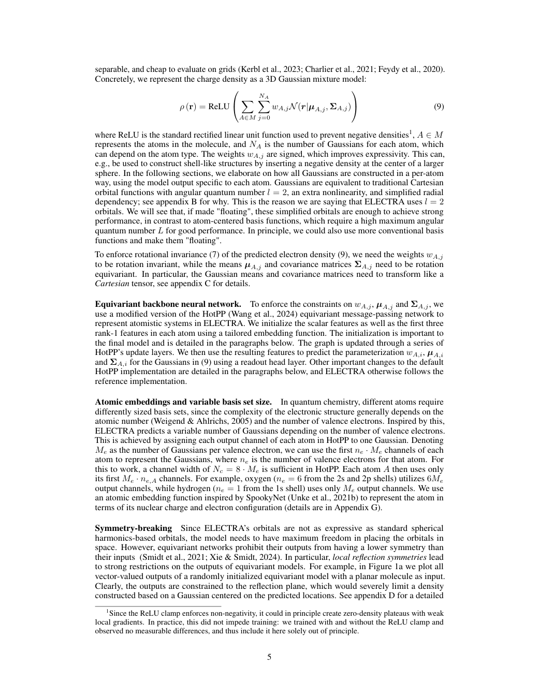

图源：用户项目中N21原文PDF，第5页。整页保留上下文，HTML中点击可放大；这是原文页面，不是本资料重绘的结果。

## 11 / N04　∇²DFT：面向药物样分子的量化数据与基准

**原文标题：** ∇²DFT: A Universal Quantum Chemistry Dataset of Drug-Like Molecules and a Benchmark for Neural Network Potentials

**年份与来源：** 2024；NeurIPS 2024 Datasets and Benchmarks。

**先补这些章节：** [02](#b02) 构象；[05](#b05) 力；[10](#b10) 电子矩阵；[21](#b21) 数据划分。

### 先定位这篇的任务

字段 | 原文支持的结论
--- | ---
模型 | 10个神经模型：SchNOrb、PhiSNet、QHNet、SchNet、DimeNet++、PaiNN、Graphormer3D、GemNet-OC、EquiformerV2、eSCN。
输入形式 | 原子序数z和三维坐标X组成的构象；监督数据含能量、力、Fock/重叠矩阵及波函数对象。
编码方式 | 各模型分别进行几何编码，没有单一通用编码；电子结构数据用def2-SVP原子轨道基表示，含矩阵和轨道系数，不能混同为输入体素图。
下游任务 | 论文中已实验评估：Fock矩阵/部分模型的重叠矩阵预测、构象能量与原子力预测、构象几何优化。

**总体数据流：** 药物样分子与构象 → 统一量化计算和划分 → 能量、力、电子矩阵与优化基准。

### 为什么作者要做这个研究

训练神经网络势需要大量一致的量化标签，也需要能区分“见过同一分子的不同构象”和“完全没见过的分子骨架”的测试。本文主要建设数据集及基准，研究不同模型能否预测电子结构、能量和力，以及能否实际完成几何优化。

### 先把它当作“试卷和题库”来读

这篇的主贡献是提供一致的量化标签和有区分度的测试，不是提出一个唯一网络。每个分子的不同构象是一道不同几何题，标签包括能量、力和AO基底下的电子矩阵。不同模型分别参加不同任务，不能把十个模型拼成一条统一编码流水线。

一个样本可以从MOSES中的分子开始，生成若干三维构象，聚类减少近重复，再以ωB97X-D/def2-SVP计算标签。MOSES是分子来源库，∇²DFT才是本文构建的量化数据；轨迹结构是另一类带优化过程信息的样本。

### 为什么“姿势见过没”和“分子见过没”要分开

假设训练里有乙醇的100种构象，测试第101种，它还可以利用对乙醇组成和连接的认识；如果测试换成完全不同的环状骨架，难度明显不同。论文提供多种划分，目的就是避免只用最容易的成绩代表广泛泛化。

大数据统计要按层次读：分子数、静态构象数、优化轨迹数与总几何数不同。一个轨迹包含许多相邻结构，相邻帧很相似，因此也不能把每一帧都视为完全独立的新化学知识。

### 三个任务怎样衔接

矩阵任务预测F/H等电子结构矩阵；能量/力任务预测标量E与每个原子的向量F；优化任务反复调用模型移动核位置，检查能否到达合适的局部极小值。前一任务表现好，不会自动证明后两项都好。

轨迹微调为什么有用？只见过接近平衡的结构，模型可能不知道沿途失真的键应该往哪边修。优化轨迹给它展示实际优化会遇到的结构。Table 5中成功率提升的含义是满足该表的计算判据，不是“设计药物成功率”。

### 读Universal时要加上范围

本文覆盖大量药物样中性闭壳层分子的相关任务，但不能自动覆盖离子、自由基、溶液、蛋白复合物或任意元素。数据丰富也不代表每个模型在同等预算内都训练充分。比较架构时要看训练量、收敛和成本。

**自测1：矩阵24×24表示24个原子吗？** 不一定，它可表示24个AO基函数。**自测2：生成更多构象等于更多化学组成吗？** 不等于。**自测3：安装数据框架后就能重现优化成功率吗？** 还需对应数据、权重、划分、超参数和优化判据。

### 回到原文的方法步骤

**步骤1 / 构建多种构象：** 从MOSES药物样分子出发生成结构，并用统一的量化设置计算。静态构象之外，作者保留几何优化沿途的结构，让模型接触偏离平衡态的位置。

**步骤2 / 保留丰富标签：** 除总能量和原子力，还提供Fock Hamiltonian、重叠矩阵、分子轨道系数与波函数对象。前两者是原子轨道基底下的电子结构矩阵，不能简单等同于三维密度图片。

**步骤3 / 统一比较任务：** 基准涵盖SchNOrb、PhiSNet、QHNet及SchNet、DimeNet++、PaiNN、Graphormer3D、GemNet-OC、EquiformerV2、eSCN等模型，采用12种预定义划分比较不同泛化难度。

### 数据集分别用在哪里

名称 / 描述 | 用途 | 规模或划分 | 要特别注意
--- | --- | --- | ---
Molecular Sets (MOSES) / ZINC Clean Leads | 来源库 | 筛选后1,936,929个分子 | C、N、S、O、F、Cl、Br、H；由来源分子生成和聚类构象。
∇²DFT | 能量、力、电子矩阵等基准 | 12,676,264个构象 | ωB97X-D/def2-SVP；包含Hamiltonian、重叠矩阵、波函数等标签。
optimization trajectories / ∇²DFTopt | 几何优化及轨迹微调 | 16,974个分子、60,226个起始构象；计入轨迹共15,716,667个几何结构 | 预定义构象、结构、骨架等测试；论文另给轨迹数据划分，不能将全部结构数量当训练集大小。

QM9、MD17、ANI等在Related Work或外部比较中出现，并非本文重新在这些数据上训练全部基准模型。

### 结果怎样读

论文实验 | 作者报告的结果 | 适用口径
--- | --- | ---
电子矩阵预测 | PhiSNet在文中比较中较好 | 大规模训练仍可能未收敛，计算成本很高
GemNet-OC优化成功率 | 90.71% → 94.55% | 使用轨迹微调；论文Table 5的成功判据
PaiNN优化成功率 | 77.09% → 84.35% | 同一优化基准；不是药物发现成功率

数据量增加通常能改善预测，但几何优化需要模型给出可靠的局部力方向。加入优化轨迹让模型接触优化过程真正会遇到的非平衡结构，因此比只记住平衡构象更接近应用需求。单看最终结构的RMSD，可能遗漏能量或收敛失败。

### 局限与不能直接推出的结论

数据范围仍有限：文中未覆盖溶液分子、蛋白–配体复合物、带电与开壳层体系。“Universal”应放在该数据集的药物样分子任务范围内理解。高质量标签也不意味着模型自动得到准确结合自由能，或能够直接筛出有效药物。

### 在综述里怎样串起来

在综述中它更适合作为数据基础和评价方法，而非密度预测算法。它提醒我们同时记录分子数、构象数、标签种类和数据划分，避免把“结构数量大”误写成“独立分子数量大”。

### 原文证据与阅读定位

原文PDF第2–3页：数据及划分；第5–6页：构建流程和数据统计；第7–9页：基准、Table 5及§5局限。

**模型短引：** “SchNOrb”；PDF页序第7页，§4 Benchmark setup and results。这段支持上面的模型说明；完整上下文请回原文。

**编码方式短引：** “ωB97X-D/def2-SVP”；PDF页序第5页，§3 Dataset；另见Table 2 p6。这段支持上面的编码方式说明；完整上下文请回原文。

[打开本地原文PDF](../../03_%E5%8E%9F%E5%A7%8B%E6%96%87%E7%8C%AE/N04.pdf#page=6)；[打开已有黄色高亮标注版](../../02_%E8%AE%BA%E6%96%87%E9%98%85%E8%AF%BB%E6%88%90%E6%9E%9C/%E9%98%85%E8%AF%BB%E4%BA%BA2_%E8%AE%BA%E6%96%87%E6%95%B4%E7%90%86/%E5%8E%9F%E6%96%87%E6%A0%87%E6%B3%A8/N04_%E5%8E%9F%E6%96%87%E6%A0%87%E6%B3%A8.pdf)；[原文/出版社入口](https://papers.nips.cc/paper/2024/file/40d45b1e23d00d5895e65778e85cf8ee-Paper-Datasets_and_Benchmarks_Track.pdf)。

**作者代码相关入口：** [查看仓库](https://github.com/AIRI-Institute/nablaDFT)。需另核对对应版本、数据与权重。

仓库说明依据原文及项目历史核对记录；本次没有重新验证所有仓库的当前可运行性，也没有下载大型数据或训练模型。

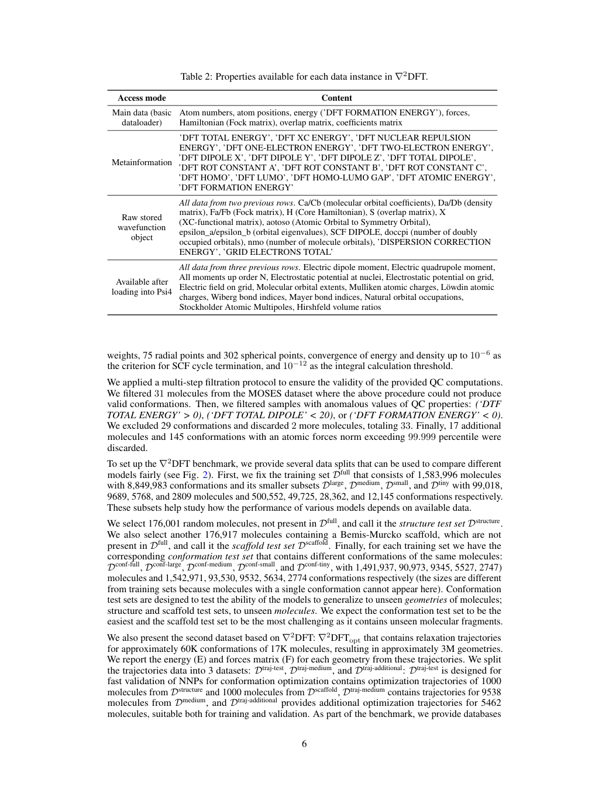

图源：用户项目中N04原文PDF，第6页。整页保留上下文，HTML中点击可放大；这是原文页面，不是本资料重绘的结果。

## 12 / L11　实验口袋密度驱动的三维分子生成

**原文标题：** A pocket-based 3D molecule generative model fueled by experimental electron density

**年份与来源：** 2022；Scientific Reports 12, 15100。

**先补这些章节：** [18](#b18) 实验图；[21](#b21) 张量与数据；[24](#b24) 生成模型；[26](#b26) 活性边界。

### 先定位这篇的任务

字段 | 原文支持的结论
--- | ---
模型 | 条件GAN（V-Net 3D生成器、复合物/配体两个判别器）生成配体密度；VQ-VAE2和条件PixelCNN将密度转成分子。
输入形式 | 蛋白口袋的实验电子密度2Fo–Fc图；配体计算电子密度作为训练标签。
编码方式 | 密度体素化为24 Å立方区域、0.5 Å间距，单通道1×48×48×48张量；VQ-VAE2双层离散码本，潜变量网格6³/12³。
下游任务 | 论文中已实验评估：面向HPK1、SARS-CoV-2主蛋白酶、VDR口袋的三维分子生成，并评价药物样性、可合成性和结合模式。

**总体数据流：** 实验口袋密度 → 生成配体密度并约束分子有效性 → 骨架与片段重建分子。

### 为什么作者要做这个研究

以蛋白口袋为条件生成分子时，既要让分子适合口袋，又要保证它能够组成合理的化学结构。本文用电子密度连接这两种要求：先学习口袋对应的配体空间分布，再从分布中恢复分子。

### 一句话里藏了三个不同问题

第一问：给定口袋，哪里适合出现配体密度？第二问：这团密度能否由合理分子产生？第三问：怎样把连续密度变成带元素和化学键的结构？如果只做第一问，模型可能画出一团填得很好、化学上却造不出来的东西。

因此论文把任务拆成口袋到filler密度、约束到可成分子的密度空间、密度到结构的解释模块。filler是模型希望填充口袋的中间场，不能把它直接当作已经确定原子的配体。

### 沿着张量和潜变量走一遍

输入口袋图被放进24 Å的立方盒，以0.5 Å间隔体素化，张量为1×48×48×48。1是强度通道，后三个维度是空间，不是48个原子。V-Net利用三维卷积和跨层信息生成配体场，两个判别器分别检查配体自身与口袋组合的合理性。

VQ-VAE2把配体密度压缩成离散潜码，层级网格6³/12³记录不同尺度信息。PixelCNN在条件下逐步采样潜码，再解码成密度。潜码像一套表达局部模式的词汇，但一个码字不等于一个确定化学片段或原子。

最后还要识别骨架、检索/替换并连接片段，才能得到分子。片段库和重建规则是流程的一部分，所以结果不能只归功于GAN或某个神经网络损失。

### 两类密度与几类数据库都要分清

口袋条件来自处理过的实验2Fo−Fc图，配体训练标签由GFN2-xTB计算。两者有不同噪声、标度和分辨率。PDBbind提供复合物相关训练对；200万分子、4000万构象的配体密度集用于其他模块，原文相关段落没有明确其来源库，不能自行补成PubChem。

PubChem衍生片段库用于结构重建，SMU-RUL用于化学空间背景，文献/专利活性分子用于评价。这些数据库不是都喂给同一个网络做相同训练。

### 如何理解验证力度

论文对HPK1、3CLpro和VDR做生成与计算评价，检查有效性、QED、SAS和结合模式相似性等。已知活性分子有实验活性，不代表所有新生成分子都有新的湿实验活性证明。相同口袋姿态也不是相同亲和力。

**自测1：本文是扩散模型吗？** 不是。**自测2：一份PDB坐标是否直接满足输入要求？** 还需对应图或按文中方式构造并处理的图。**自测3：基线的GitHub能当作本文源码吗？** 不能，原文只说明部分代码可依合理请求申请。

### 回到原文的方法步骤

**步骤1 / 生成口袋中的填充密度：** 条件GAN使用V-Net三维生成器，以及复合物和配体判别器，从实验口袋密度产生配体的“filler”密度。训练损失对非共价相互作用区域加权，强调界面附近的匹配。

**步骤2 / 学习可成分子的密度空间：** 另一个VQ-VAE2利用更多计算得到的配体密度学习离散潜变量；条件PixelCNN依据filler密度采样，使生成结果更接近可由真实分子产生的密度。

**步骤3 / 密度到化学结构：** 模型重建密度后，再进行骨架提取和片段替换、连接。因此最终有效性也依赖后续重建规则与片段处理，不能把整个流程简化为一次神经网络预测。

### 数据集分别用在哪里

名称 / 描述 | 用途 | 规模或划分 | 要特别注意
--- | --- | --- | ---
PDBbind | filler密度生成模型训练 | 12,905个复合物，提取27,006个蛋白–配体对 | 实验口袋2Fo-Fc图作输入，计算配体密度作标签；参考口袋相似性做训练/测试划分。
作者构建的配体构象密度集（无正式库名） | VQ-VAE2及原子检测模型训练 | 200万个QED>0.3分子；每分子20构象，共4,000万构象密度 | 密度由xTB计算。该方法段未明确给出这200万分子的具体来源库名，故不擅自与SMU-RUL或PubChem画等号。
PubChem衍生片段库 | 片段检索、替换、组装 | 35种反应模板；超过27万片段；350万三维构象 | 属于结构重建用库，不是PDBbind口袋训练对。PubChem样本还用于化学空间对比。
SMU-RUL | SOM化学空间背景 | 880万个分子 | 用于构建化学空间，不是880万个靶点活性标签。
作者整理的文献/专利活性参考集（描述） | HPK1、3CLpro、VDR评价 | 超过8,000个化合物，来自144篇文献/专利 | 用于结构相似性、活性分组和作用模式分析；生成样本数量不当作来源数据集规模。

“训练数据”“片段库”和“评价参考分子”应分开写。论文未在所核对段落给出PDBbind版本，不补猜版本号。

### 结果怎样读

论文实验 | 作者报告的结果 | 适用口径
--- | --- | ---
测试靶点 | HPK1、3CLpro、VDR | 每个靶点生成10,000个分子以检查有效性等指标
化学评价 | QED、SAS、化学空间与相似性 | SAS较有利；QED并非所有比较中最佳
相互作用评价 | NCI/IGM特征与结合模式比较 | 观察到与已知活性分子接近的作用模式及新骨架

作者展示了把实验口袋图与计算配体密度结合的生成路线。它利用空间分布提供结构条件，再借助分子密度潜空间改善有效性。这比仅按形状塞入原子多了一层化学可实现性的约束。

### 局限与不能直接推出的结论

论文中的性质分数、相似性和相互作用分析主要属于计算验证，不能据此认定新生成分子已经通过生化实验。实验图经过分辨率处理，也不能当作逐点精确的量化电子数密度。生成能力受口袋信息质量、训练分布和片段重建环节影响。

### 在综述里怎样串起来

它是9篇中最直接连接蛋白口袋与分子生成的研究。与ELECTRA、GPWNO“预测已有结构的密度”不同，这里用密度作为生成中间条件。可与后文ED2Mol一起比较条件来源、密度到分子的步骤和实验验证程度。

### 原文证据与阅读定位

原文PDF第2–4页与Fig.1：总体框架；第6–8页：结果与讨论；第10–12页Methods：数据、V-Net、VQ-VAE2和结构重建。

**模型短引：** “V-Net”；PDF页序第10页，Methods: Ligand ED generative model；p11。这段支持上面的模型说明；完整上下文请回原文。

**编码方式短引：** “0.5 Å cubic grid”；PDF页序第11页，Methods: Ligand structure generative model。这段支持上面的编码方式说明；完整上下文请回原文。

[打开本地原文PDF](../../03_%E5%8E%9F%E5%A7%8B%E6%96%87%E7%8C%AE/L11.pdf#page=2)；[打开已有黄色高亮标注版](../../02_%E8%AE%BA%E6%96%87%E9%98%85%E8%AF%BB%E6%88%90%E6%9E%9C/%E9%98%85%E8%AF%BB%E4%BA%BA2_%E8%AE%BA%E6%96%87%E6%95%B4%E7%90%86/%E5%8E%9F%E6%96%87%E6%A0%87%E6%B3%A8/L11_%E5%8E%9F%E6%96%87%E6%A0%87%E6%B3%A8.pdf)；[原文/出版社入口](https://www.nature.com/articles/s41598-022-19363-6.pdf)。

**代码边界：** 原文说明部分代码可依合理请求向通信作者申请；不提供冒充本文的基线GitHub。

仓库说明依据原文及项目历史核对记录；本次没有重新验证所有仓库的当前可运行性，也没有下载大型数据或训练模型。

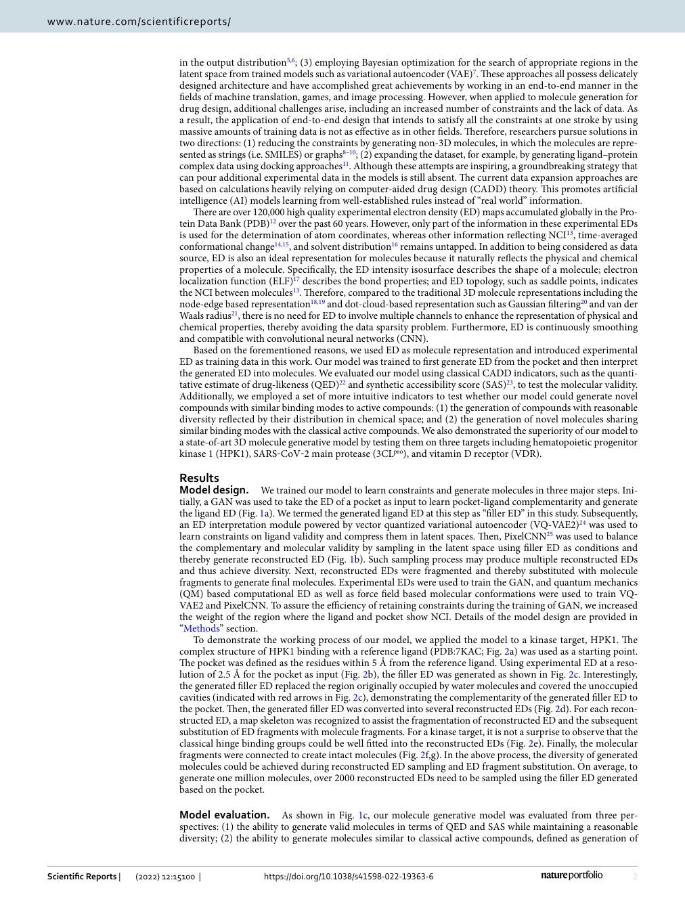

图源：用户项目中L11原文PDF，第2页。整页保留上下文，HTML中点击可放大；这是原文页面，不是本资料重绘的结果。

## 13 / N08　xTB：用较低成本计算电子结构

**原文标题：** Extended tight-binding quantum chemistry methods

**年份与来源：** 2021；WIREs Computational Molecular Science 11, e1493。

**先补这些章节：** [07](#b07) 电子结构；[09](#b09) AO基；[11](#b11) SCF；[19](#b19) 非共价作用。

### 先定位这篇的任务

字段 | 原文支持的结论
--- | ---
模型 | 综述GFN1-xTB、GFN2-xTB、GFN0-xTB、sTDA-xTB和GFN-FF；核心是半经验紧束缚方法族。
输入形式 | 分子元素组成、笛卡尔坐标；多数常规计算只需输入几何。本文没有神经网络训练输入的统一格式。
编码方式 | 以最小价电子为主、部分极化的球形GTO原子轨道基；轨道作AO线性组合，通过Hamiltonian/重叠矩阵求解电子结构。
下游任务 | 综述应用：几何优化、振动频率、非共价相互作用、构象搜索和MD；特定变体处理光谱、反应路径、周期体系。

**总体数据流：** 原子结构 → 半经验紧束缚近似 → 几何、能量与电子结构信息。

### 论文类型与位置

这是半经验量子化学方法综述，不能套成一个统一的神经网络训练故事。

### 先回答：它为什么在一组AI论文中

这篇是量子化学方法综述，主要帮助理解便宜电子结构标签怎样产生。L11等工作采用GFN2-xTB生成密度相关数据；如果不懂这个计算层级，就容易把近似标签当作高精度实验真值。

xTB不是从头求解完整多电子问题，而是用紧凑AO基与经过参数化的近似降低成本。它依旧利用电子结构和有效Hamiltonian的思想，与纯粹按固定原子类型套弹簧的力场有不同信息量。

### GFN几个字母到底管什么

GFN对应几何、振动频率和非共价相互作用，强调这些目标是参数化重点。它不是保证所有化学反应能、激发态和电子性质都同等准确的通用承诺。参数化参考数据也不同于神经网络常说的统一训练/验证/测试划分。

GFN1-xTB和GFN2-xTB需要自洽；GFN2包含各向异性多极静电与D4色散等处理；GFN0-xTB避免SCF，进一步降低成本；GFN-FF是力场，不能说它也提供同等层次的显式电子波函数。sTDA-xTB等变体服务不同光谱相关任务。

### 一个实际的使用逻辑

假设一个分子有几千种候选构象，直接全做昂贵计算成本高。可以先用较便宜方法搜索与筛选，保留少量候选再提高理论层级。每一步都应检查目标量是否适合该方法，不能只因为程序跑得快就忽略错误的电荷、构象或电子态。

优化输出的是局部极小值候选，频率可帮助检查局部性质；虚频、收敛失败或不合理结构应回查。这个教学流程不等于本机已经做完所有构象的高精度筛选。

### 和密度学习最相关的边界

小基与半经验参数化提高效率，也限制了能表达的细节。用xTB密度提取QTAIM特征时，近似误差可能传播到图特征；但下游差也不能只归因于xTB，还可能是任务、图构造、训练量和缺少自由能因素。

**自测1：xTB的“训练”一定指深度神经网络吗？** 不是。**自测2：GFN-FF和GFN2-xTB可视作同一个量化求解器吗？** 不能。**自测3：先低成本再高精度一定不漏掉好构象吗？** 也不能保证，筛选门槛会产生偏差。

### 回到原文的方法步骤

**论文在讲什么：** 这是一篇方法综述，介绍xTB家族的理论、实现和应用。正式卷期为2021年，在线发表于2020年。GFN1-xTB、GFN2-xTB和GFN0-xTB用参数化近似降低计算成本，重点服务几何、振动频率和非共价相互作用等任务。

**方法与表示：** 分子轨道由以原子为中心的紧凑基函数组合。GFN1/2需要自洽求解，GFN2加入各向异性多极静电与D4色散；GFN0避免SCF。GFN-FF属于力场，应与显式电子结构方法区分。

**能做什么与边界：** 可用于构象筛选、几何优化、分子动力学等。它以近似换取效率，适用性仍随体系和目标量变化。

### 数据集分别用在哪里

名称 / 描述 | 用途 | 规模或划分 | 要特别注意
--- | --- | --- | ---
ROT34 / HMGB11 / LB12 / S22 / S22x5 / S66x8 / X40x10 | 结构与非共价几何评价 | ROT34含12种结构、34个转动常数；其余按原文集合 | 官方全文§4.1。
TMC32 / TMG145 / 镧系配合物集合 | 金属配合物结构评价 | TMG145含145个配合物；另有80个镧系结构 | 官方全文§4.1。
GMTKN55非共价子集 | 相互作用能评价 | 分组列示，非合并训练集 | 官方全文§4.2、Fig.10。
ACONF等构象子集 / MALT205 | 构象能评价 | MALT205含205个麦芽糖构象 | 官方全文§4.2。
S30L等结合能、势垒与金属反应集合 | 大分子结合能、势垒和金属反应评测 | S30L含30个复合物；集合分别评测 | 官方全文§4.2–4.3。这里只列主要具名评测，不将综述引用的每个应用案例都当独立数据集。

本项目现有49页扫描标注版；扫描版不能按文本搜索。本节同时参考出版社全文，不补造一个统一训练集。

### 对这篇应怎样报告结果

它汇总不同方法和评测集合，没有一个可代表所有GFN方法的统一精度。按目标量和体系分开报告，不把参数化评测等同于神经网络测试集。

### 原文证据与阅读定位

出版社全文§1–4；本项目另有49页扫描标注版。扫描PDF页序与网页小节是两套定位方式；不把网页段落伪称为可搜索PDF文本。

**模型短引：** “GFN1-xTB”；出版社全文§1，§1 Introduction。这段支持上面的模型说明；完整上下文请回原文。

**编码方式短引：** “Gaussian-type atomic orbital”；出版社全文§2.1.2，§2.1.2 The wavefunction choice。这段支持上面的编码方式说明；完整上下文请回原文。

[打开本地扫描标注PDF](../../%E6%96%87%E7%8C%AE%E6%A0%87%E6%B3%A8/wcms.1493_N08%E6%A0%87%E6%B3%A8.pdf)；[原文/出版社入口](https://wires.onlinelibrary.wiley.com/doi/full/10.1002/wcms.1493)。

**作者代码相关入口：** [查看仓库](https://github.com/grimme-lab/xtb)。xtb是程序；构象搜索另见[CREST](https://github.com/crest-lab/crest)。

仓库说明依据原文及项目历史核对记录；本次没有重新验证所有仓库的当前可运行性，也没有下载大型数据或训练模型。

## 14 / L25　SA-GPR：从小片段学习非共价体系的密度

**原文标题：** Electron Density Learning of Non-Covalent Systems

**年份与来源：** 2019；Chemical Science 10, 9424–9432。

**先补这些章节：** [09](#b09) 辅助基；[16](#b16) 球谐；[19](#b19) 弱相互作用；[20](#b20) 核方法；[23](#b23) 等变。

### 先定位这篇的任务

字段 | 原文支持的结论
--- | ---
模型 | 对称适配高斯过程回归SA-GPR，预测原子中心密度展开系数。
输入形式 | 分子原子坐标与原子中心局域环境；训练对象为BFDb筛选的2291个侧链二聚体。
编码方式 | O(3)对称适配环境核描述局域原子环境；电子密度在cc-pVQZ/JKFIT RI辅助基上展开，回归系数并重建连续密度。
下游任务 | 论文中已实验评估：非共价相互作用DORI可视化、静电势与残基间静电相互作用分析，以及向8条多肽的密度预测迁移。

**总体数据流：** 原子局部环境 → 对称性适配高斯过程回归 → 密度系数与相互作用描述。

### 为什么作者要做这个研究

非共价作用常发生在电子密度很低的区域，变化很细微。模型若只把核附近的高密度区域预测好，仍可能看错氢键或芳香堆积。作者研究能否从较小的分子片段学习密度，并推广到更大的多肽，用于分析非共价作用。

### 为什么不直接学一整块大网格

大分子的网格很大，而局部化学环境经常重复。作者把密度写成原子中心基函数之和，学习每个环境对应的展开系数。这样可以在小片段上学习局部规律，再用于更大体系。

示意公式是ρ(r)≈Σ_A,n,l,m c_Anlm R_nl(|r−R_A|)Y_lm(方向)。A标原子，n标径向函数，l、m标角向部分。网络/核模型主要预测c，基函数负责把系数变回空间场。这里的辅助基展开是有正有负的数学组合，不必把每个系数读成电子数。

### SA-GPR“对称性适配”具体帮了什么

如果一个局部环境旋转，带方向的密度特征也应旋转。普通只预测一组固定标量系数的方法可能把方向弄错。SA-GPR让局部环境核和系数的变换规律相匹配，使重建场随结构正确变化。

它不是要求每个系数在旋转前后都一样。球对称分量与方向分量的规则不同；这和把一张图片随机旋转很多次做数据增强也不是同一件事。第一遍看方法，先识别输入环境、输出系数和重建公式三部分。

### 非共价区域为什么是更苛刻的考试

若核附近密度很大，即使相互作用区有相对明显误差，总误差仍可能显得很小。作者进一步比较DORI、静电势与作用分析，是在检查模型有没有保留对化学判断有用的低密度信息。

训练使用BFDb的SSI侧链二聚体筛选集，共2291个结构，2000训练、291测试；再在8个PDB多肽上考察迁移。参考电子结构为ωB97X-D/cc-pVQZ，展开辅助基为cc-pVQZ/JKFIT。牢记“产生参考”和“表示输出”的基组不同。

### 片段可迁移性何时可能失效

如果大体系的局部环境已在训练片段中出现，局部规律可能沿用；若出现新的肽键环境、张力或长程电荷影响，局部模型可能不足。多肽误差高于二聚体，并不是矛盾，恰好说明迁移有代价。

**自测1：局部环境相同，总密度一定完全相同吗？** 远处电性仍可能影响。**自测2：8个多肽是训练数据吗？** 此处是迁移测试。**自测3：作者仓库包含完整SA-GPR训练吗？** 现有配套RHO-Decomposition主要负责分解，不能冒称完整复现流水线。

### 回到原文的方法步骤

**步骤1 / 把密度拆成基函数：** 先用原子中心辅助基函数展开参考密度，再预测展开系数。本文选用cc-pVQZ/JKFIT密度拟合辅助基组，它的用途是展开密度，需与计算分子轨道所用的基组区别。

**步骤2 / 在系数层面保持对称性：** SA-GPR即对称性适配高斯过程回归。它用原子周围的局部环境预测带角向信息的系数，让分子旋转时系数按相应规律变化，重建后的空间密度随之旋转。

**步骤3 / 从密度计算衍生量：** 作者不仅比较密度，还计算DORI非共价区域、静电势及部分相互作用估计，检验低密度区域是否保留了化学信息。

### 数据集分别用在哪里

名称 / 描述 | 用途 | 规模或划分 | 要特别注意
--- | --- | --- | ---
SSI subset of the BioFragment database (BFDb) | 主要训练/测试数据 | 原SSI有3,380个二聚体；筛选后2,291；随机2,000训练、291测试 | 去掉超过25原子和含硫的结构；参考密度为ωB97X-D/cc-pVQZ。
8个PDB多肽（迁移测试，描述） | 较大体系的迁移测试 | 8个多肽 | 以BFDb训练好的模型预测，不把8个多肽写成训练集。

本地原文PDF含额外封面，证据页码使用PDF页序：主要数据段在第4页。

### 结果怎样读

论文实验 | 作者报告的结果 | 适用口径
--- | --- | ---
侧链二聚体密度 | 约0.2%–0.3%的误差量级 | 使用论文的密度误差定义和相应训练设置
多肽迁移 | 8个多肽，平均密度误差约1.5% | 比二聚体测试更难，显示环境覆盖的重要性
衍生量验证 | DORI、静电势和堆积作用分析 | 证明模型在文中例子中保留了部分非共价信息

这篇的重点是把学习对象从一个巨大三维数组变成带物理对称性的局部展开系数。基函数提供形状先验，核方法在较小训练集上学习局部规律。多肽测试说明“训练在小体系、应用到较大体系”具有一定可行性。

### 局限与不能直接推出的结论

带明显静电作用的二聚体误差相对更大，说明局部输入与长程相互作用之间仍有矛盾。多肽的肽键和受张力环状骨架也可能超出训练覆盖。文中约500倍加速是特定enkephalin及参考设置下的例子，不能概括成任何分子都固定加速500倍。

### 在综述里怎样串起来

适合放在“密度表示”和“非共价相互作用分析”之间。它提供密度下游验证的范例，但并未直接证明亲和力预测或药物活性提升。与后文QTAIM图研究可比较：一个学习完整密度，再取衍生量；另一个直接把衍生特征交给性质模型。

### 原文证据与阅读定位

本地PDF含封面：第3–4页为方法，第5–8页为主要结果。正文对应期刊9425–9430页附近；引用时以本地PDF页码为准。

**模型短引：** “symmetry-adapted Gaussian process regression”；PDF页序第3页，§1–§2 Methods。这段支持上面的模型说明；完整上下文请回原文。

**编码方式短引：** “cc-pVQZ/JKFIT”；PDF页序第4页，§2 Methods；局域性讨论PDF p5。这段支持上面的编码方式说明；完整上下文请回原文。

[打开本地原文PDF](../../03_%E5%8E%9F%E5%A7%8B%E6%96%87%E7%8C%AE/L25.pdf#page=4)；[打开已有黄色高亮标注版](../../02_%E8%AE%BA%E6%96%87%E9%98%85%E8%AF%BB%E6%88%90%E6%9E%9C/%E9%98%85%E8%AF%BB%E4%BA%BA2_%E8%AE%BA%E6%96%87%E6%95%B4%E7%90%86/%E5%8E%9F%E6%96%87%E6%A0%87%E6%B3%A8/L25_%E5%8E%9F%E6%96%87%E6%A0%87%E6%B3%A8.pdf)；[原文/出版社入口](https://pubs.rsc.org/en/content/articlehtml/2019/sc/c9sc02696g)。

**作者代码相关入口：** [查看仓库](https://github.com/lcmd-epfl/RHO-Decomposition)。这是密度分解配套代码，不是完整SA-GPR训练流程。

仓库说明依据原文及项目历史核对记录；本次没有重新验证所有仓库的当前可运行性，也没有下载大型数据或训练模型。

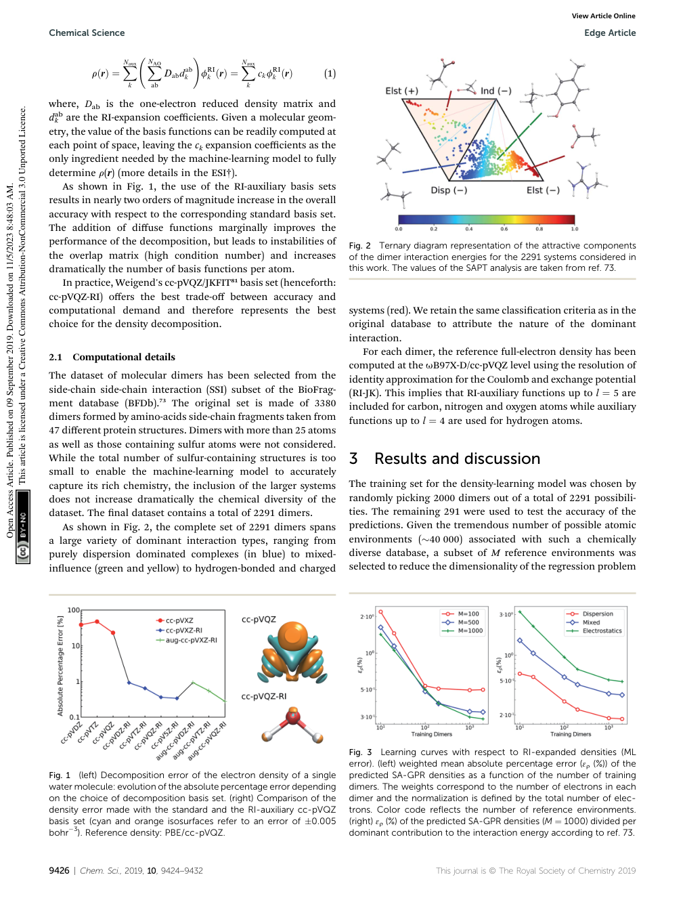

图源：用户项目中L25原文PDF，第4页。整页保留上下文，HTML中点击可放大；这是原文页面，不是本资料重绘的结果。

## 15 / N03　EG-XC：学习DFT里的非局域交换关联泛函

**原文标题：** Learning Equivariant Non-Local Electron Density Functionals

**年份与来源：** 2025；ICLR 2025。

**先补这些章节：** [12](#b12)–[14](#b14) DFT与泛函导数；[16](#b16) 球谐；[22](#b22)–[23](#b23) 消息传递。

### 先定位这篇的任务

字段 | 原文支持的结论
--- | ---
模型 | EG-XC：用等变GNN（NequIP消息传递）学习非局域交换相关泛函，与meta-GGA及图读出结合。
输入形式 | SCF迭代中的电子密度场ρ(r)、核位置、积分点/权重及半局域密度量；训练监督仅需总能量目标。
编码方式 | 软分区密度与径向滤波、球谐函数卷积，得到SO(3)等变的核中心点云；再经等变消息传递产生非局域特征。
下游任务 | 论文中已实验评估：分子能量/势能面、3BPA分布外构象与QM9分子尺寸外推；这是DFT内的泛函模型。

**总体数据流：** 当前密度与核位置 → 等变图网络构造非局域信息 → 交换关联能并参与SCF。

### 为什么作者要做这个研究

DFT中交换关联能的精确形式未知，常用近似主要依赖一个点附近的密度信息，难以充分反映远处环境。本文把等变图网络嵌入交换关联泛函，让局部密度与更大范围的分子结构共同参与能量计算。

### 先把它放回DFT内部

EG-XC输入的不是一份最终密度标签，让网络一次输出答案；它接收SCF当前密度及核位置等信息，计算交换关联能贡献，再由求解器更新轨道和密度。它改变求解器内部的一条规则。

沿一个水样本走：初猜ρ₀ → 根据当前ρ₀构造等变密度特征 → 消息传递得到非局域特征 → 输出E_xc并得到所需响应 → 求KS轨道 → 得到ρ₁ → 再循环。参数固定后的推理仍要运行这个自洽过程。

### 密度怎样变成一个原子图

连续密度点太多，作者用软分区把积分区域关联到不同核，并以径向滤波和球谐投影形成核中心特征。软分区允许平滑分配，不是把每个网格点粗暴判给最近原子。

接着用NequIP式等变消息传递，使各核中心特征交流，增加非局域环境信息；再结合半局域meta-GGA及图读出得到能量。可以把它看成“从完整场提取方向摘要，再让摘要交流”，但实际数学定义以Eq.9–14为准。

### 只有能量标签，为什么还能训练这一串计算

训练损失可比较自洽后的能量与参考能量。可微SCF让误差对模型参数的导数穿过求解过程，从而更新泛函。**能量监督**不等于“输入没有密度”，也不等于“没有计算密度”。输入、中间变量和监督目标是三种角色。

能量对参数可微也不保证优化容易。SCF稳定性、导数的数值行为和泛化都可能带来困难。尤其不能由更小能量MAE直接推断每个位置的密度都更正确。

### non-local与泛化实验怎样理解

半局域近似主要依赖某点及其附近导数量，EG-XC通过图网络让更远环境影响表达。文章用修订MD17、跨温度3BPA和按大小划分QM9检验不同挑战。但有限图感受野与有限训练集并不等于解决一切长程或强相关问题。

**自测1：训练标签是密度还是能量？** 此文强调仅需能量目标。**自测2：它是否绕过KS？** 没有。**自测3：结果能叫严格普适的纯密度泛函吗？** 模型显式利用核位置等信息，需保留论文讨论的理论与适用性限制。

### 回到原文的方法步骤

**步骤1 / 将密度投影到原子周围：** 用软分区把密度信息关联到各个原子，并结合径向滤波和球谐函数形成带方向的特征。它保留了比单个原子的元素或电荷更丰富的电子分布信息。

**步骤2 / 在原子间传递非局域信息：** 以NequIP等变消息传递交换各原子的特征，使一个位置的能量表达能够参考更远的分子环境。输出与半局域meta-GGA部分及图读出共同构成交换关联能。

**步骤3 / 在自洽过程中训练：** 通过可微SCF把能量误差反传至泛函参数。训练使用能量标签，不要求参考密度作为监督目标；模型改变的是DFT内部的能量近似，而不是直接一次性从坐标输出最终密度。

### 数据集分别用在哪里

名称 / 描述 | 用途 | 规模或划分 | 要特别注意
--- | --- | --- | ---
revised MD17 dataset | 五种分子分别拟合、测试 | 每分子950训练+50验证；另500测试，乙醇1,000测试 | 五种为阿司匹林、苯、乙醇、丙二醛、甲苯。CCSD(T)参考，阿司匹林为CCSD。
3BPA | 跨温度及二面角构象外推 | 500个300 K结构训练；测试300/600/1200 K轨迹及三组二维势能面切片 | ωB97X/6-31G(d)能量标签。
QM9(S) | 小分子到较大分子的大小外推 | 按最多S个重原子取子集，90%/10%训练/验证；其余较大分子测试 | 剔除含氟分子；使用B3LYP/6-31G(2df,p)能量，不是QM9的VASP密度扩展。

“MD17能量集”和ELECTRA/GPWNO所用的六分子密度集，标签和选择不同，应分别记录。

### 结果怎样读

论文实验 | 作者报告的结果 | 适用口径
--- | --- | ---
MD17阿司匹林能量MAE | 1.94 → 0.69 mEh | 论文半局域基线与EG-XC；Table 1
3BPA，600 K | 1.36 → 0.73 mEh | 与文中半局域模型比较；Table 2
3BPA，1200 K | 2.27 → 1.39 mEh | 检查对较高温构象的推广；Table 2

模型把电子结构求解器的约束与图网络的表达能力结合起来。跨温度、势能曲线及小到大分子的实验，试图检验比单纯插值更有意义的泛化。在Table 1五种分子中，EG-XC并非每项最优，苯的其他基线可有更低误差。

### 局限与不能直接推出的结论

训练能量变准，不足以单独保证密度的每个区域都更物理。模型依赖核位置，严格意义上不完全等同于只依赖密度的普适泛函；均匀电子气、物理约束及自旋扩展仍有挑战。它仍要做SCF，因此应用成本应与直接神经网络势分开比较。

### 在综述里怎样串起来

在综述中属于“用AI改进密度泛函”，应与“预测密度的模型”分开。可与L23对照：L23在特定任务中尝试绕开Kohn-Sham求解，EG-XC则保留求解器并学习其中的关键近似。

### 原文证据与阅读定位

原文PDF第4–6页：§4方法与局限；第7–10页：MD17、3BPA、QM9和Table 1–2。正式会议为ICLR 2025，预印本早于会议年份。

**模型短引：** “Equivariant Graph Exchange Correlation”；PDF页序第4页，§4；NequIP见p5。这段支持上面的模型说明；完整上下文请回原文。

**编码方式短引：** “spherical harmonics”；PDF页序第4页，Figure 1；Eq.9–14 p4–5。这段支持上面的编码方式说明；完整上下文请回原文。

[打开本地原文PDF](../../03_%E5%8E%9F%E5%A7%8B%E6%96%87%E7%8C%AE/N03.pdf#page=4)；[打开已有黄色高亮标注版](../../02_%E8%AE%BA%E6%96%87%E9%98%85%E8%AF%BB%E6%88%90%E6%9E%9C/%E9%98%85%E8%AF%BB%E4%BA%BA2_%E8%AE%BA%E6%96%87%E6%95%B4%E7%90%86/%E5%8E%9F%E6%96%87%E6%A0%87%E6%B3%A8/N03_%E5%8E%9F%E6%96%87%E6%A0%87%E6%B3%A8.pdf)；[原文/出版社入口](https://proceedings.iclr.cc/paper_files/paper/2025/file/7d95d65059958ba8667be1f642c6447c-Paper-Conference.pdf)。

**作者代码相关入口：** [查看仓库](https://github.com/ESEberhard/eg-xc)。论文脚注旧地址eg-ex曾失效；现有相关维护项目为[ML4DFT](https://github.com/ESEberhard/ML4DFT)，不可当作冻结的2025实验版本。

仓库说明依据原文及项目历史核对记录；本次没有重新验证所有仓库的当前可运行性，也没有下载大型数据或训练模型。

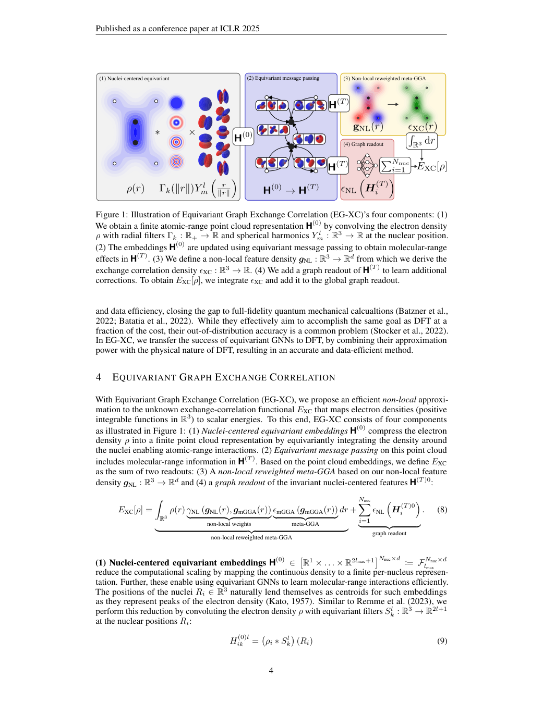

图源：用户项目中N03原文PDF，第4页。整页保留上下文，HTML中点击可放大；这是原文页面，不是本资料重绘的结果。

## 16 / N17　VisionED：把电子结构变成图像用于材料性质学习

**原文标题：** Physics-Informed Pre-training on Efficient Electron-Density Images for Organic Material Property Prediction

**年份与来源：** 2026；ICML 2026，PMLR 306。

**先补这些章节：** [17](#b17) 密度与ESP；[21](#b21) 预训练；[23](#b23) 不变性；[24](#b24) ViT。

### 先定位这篇的任务

字段 | 原文支持的结论
--- | ---
模型 | VisionED：共享ViT-Base/16图像编码器、视图集合池化及性质预测MLP，结合CAP/EGP/QSP物理预训练。
输入形式 | 每分子6张224×224 RGB电子密度图像；下游可成对输入给体–受体或发光体–溶剂图像。
编码方式 | 将ED等值面以ESP着色，从6个方向渲染；切为16×16 patches经ViT编码，再做视图平均池化。
下游任务 | 论文中已实验评估：有机光伏VOC/JSC/FF/PCE，色团吸收/发射、PLQY/FWHM预测，并测试三元混合器件趋势。

**总体数据流：** 密度等值面与静电势着色 → 六视角ViT与物理任务预训练 → 光伏与光学性质预测。

### 为什么作者要做这个研究

完整三维电子密度成本高、数据大，常规分子表示又可能丢掉与材料性质有关的电子信息。本文把密度与静电势转成多视角图像，用视觉模型做预训练，研究这种表示能否帮助有机光伏与发光材料的性质预测。

### 为何把三维信息转成图片

三维密度场很大，而成熟视觉网络能高效处理图像。作者先取密度等值面，用ESP着色，再从六个方向拍摄。这样形状与表面电性共同进入视觉模型，但内部场与等值面以外的信息有所丢失。

一个分子的输入可写为6×3×224×224：六视角、RGB三通道、图像高和宽。3不是三个电子密度通道，RGB颜色来自渲染。相机、等值面阈值、色标和分子取向都是预处理的一部分，不能任意更换后还默认与训练一致。

### 先做三种预训练题，再做真正的性质题

CAP让图像表示预测Mulliken电荷极值及对应元素；EGP回归69维ESSOR描述符；QSP用描述符聚类建立语义伪标签。三种任务让模型先从大量数据中学习与电子结构有关的模式。

69维描述符在这里是预训练监督目标，不是一律要求预测时额外输入的69个真值。QSP的类别也是计算构造的伪标签，不是人工实验认定的化学物种类别。预训练、微调和推理各阶段都要分别画清楚。

### ViT怎样处理这些图

共享ViT-Base/16把每张224×224图切成16×16 patch，编码后得到视图特征，再经视图集合聚合得到分子表示，最后接任务头。多分子任务还可能组合给体、受体或溶剂信息。

六个固定视角平均有助于减轻取向差异，但任意旋转会改变投影内容和可见表面，不能因此声称严格连续SO(3)不变。注意力图与电性直觉一致，可以作为观察，不能单独证明因果机制。

### 数据和成本如何对应

EDBench选取约200万个分子几何、渲染约1200万图；下游HOPV15、OPEP2、Deep4Chem含实验材料性质。预测的光伏与光学量不是药物活性。下游标签不同，不能把全部记录数都写成每一项任务的有效样本数。

整个流程成本包括获得电子结构、生成描述符/渲染以及模型运算。若未来用于大量未知分子，不能只报告ViT前向时间就声称端到端很便宜。

**自测1：ESP就是密度吗？** 不是。**自测2：六视图就是严格等变网络吗？** 不是。**自测3：预训练约200万结构等于200万种独立化合物吗？** 应按原文的分子几何选择口径陈述，不能自动等同。

### 回到原文的方法步骤

**步骤1 / 构造电子结构图像：** 取电子密度等值面，并以静电势着色，从六个方向渲染。一个分子对应6×3×224×224的RGB输入，密度形状和表面静电特征共同进入视觉编码器。

**步骤2 / 加入物理预训练任务：** CAP预测Mulliken电荷极值及原子类型；EGP回归69个ESSOR电子、形状、静电势、轨道和能量描述符；QSP根据这些描述符的聚类学习量子语义伪标签。

**步骤3 / 迁移到性质任务：** 采用共享ViT-Base/16和16×16图像块，聚合多视角特征后训练任务头。多视角平均能缓解方向变化影响，但不等于数学上严格的三维旋转等变。部分任务还拼接供体、受体或溶剂等信息。

### 数据集分别用在哪里

名称 / 描述 | 用途 | 规模或划分 | 要特别注意
--- | --- | --- | ---
EDBench | 预训练 | 选择约200万个分子几何；六视角约1,200万图像；80%/10%/10%划分 | 原EDBench规模超过330万，不能把原库规模写成本文实际使用量。
HOPV15 | 光伏性质、5折交叉验证及跨库测试 | 原库350种p型小分子/聚合物，含构象与实验/量化数据 | 预测VOC、JSC、FF、PCE；跨库设置从OPEP2训练、HOPV15测试。
OPEP2 | 光伏性质、供体/受体骨架划分 | 整理1,225个器件记录后保留1,000个供体–受体对；599受体、210供体 | 原始器件记录数与保留的独立配对数不同。
Deep4Chem | 吸收、发射、PLQY、FWHM | 原库20,236条色团–环境记录；7,016色团、365溶剂或固态介质 | 使用发光体/溶剂划分；各任务有效标签数不宜直接等同原库总记录数。

“原库统计”和“本文选择的预训练量”已分开。光伏的额外三元器件示例不作为另一个通用训练库。

### 结果怎样读

论文实验 | 作者报告的结果 | 适用口径
--- | --- | ---
有机光伏 | 预测VOC、JSC、FF、PCE | 检查器件相关性质，并与结构模型比较
光学任务 | 吸收、发射、量子产率、峰宽 | 文中溶剂骨架划分的吸收MAE相对改善27.0%
计算表示比较 | 六视角为成本与表现折中 | 增加到60视角收益有限，图像路线显存较低

贡献在于把电子结构知识变成可供视觉模型大规模使用的训练信号，并考察低数据量与分布外划分。预训练使模型在面对较小材料数据集时，不必完全从零开始学习电子结构与性质的关系。

### 局限与不能直接推出的结论

生成图像仍依赖电子结构计算，端到端总成本不能只看ViT推理。图像存在投影与等值面信息损失，也未覆盖动态效应及所有材料任务。文中三元器件的“PCE accuracy”按相对偏差定义，不能当作分类准确率或普遍成功率。注意力图与化学直觉一致也不构成因果解释。

### 在综述里怎样串起来

在综述中属于“电子密度作为表征或预训练信息”。它证明的是特定材料性质任务上的作用，而不是蛋白结合亲和力或药物活性。可与QTAIM-embed比较：前者把场变成图像，后者把场压缩为关键点和原子的数值特征。

### 原文证据与阅读定位

原文PDF第3–4页：多视角表示、CAP/EGP/QSP；第5–8页：实验与Tables 1–5；第9页：局限。正式来源为ICML 2026，PMLR 306。

**模型短引：** “ViT-Base/16”；PDF页序第5页，§5.1 Implementation details；§4.3–4.5。这段支持上面的模型说明；完整上下文请回原文。

**编码方式短引：** “patch size of”；PDF页序第4页，§4.3；渲染方法§4.2 p3。这段支持上面的编码方式说明；完整上下文请回原文。

[打开本地原文PDF](../../03_%E5%8E%9F%E5%A7%8B%E6%96%87%E7%8C%AE/N17.pdf#page=3)；[打开已有黄色高亮标注版](../../02_%E8%AE%BA%E6%96%87%E9%98%85%E8%AF%BB%E6%88%90%E6%9E%9C/%E9%98%85%E8%AF%BB%E4%BA%BA2_%E8%AE%BA%E6%96%87%E6%95%B4%E7%90%86/%E5%8E%9F%E6%96%87%E6%A0%87%E6%B3%A8/N17_%E5%8E%9F%E6%96%87%E6%A0%87%E6%B3%A8.pdf)；[原文/出版社入口](https://raw.githubusercontent.com/mlresearch/v306/main/assets/cheng26m/cheng26m.pdf)。

**作者代码相关入口：** [查看仓库](https://github.com/ZhixiangCheng/VisionED)。需另核对对应版本、数据与权重。

仓库说明依据原文及项目历史核对记录；本次没有重新验证所有仓库的当前可运行性，也没有下载大型数据或训练模型。

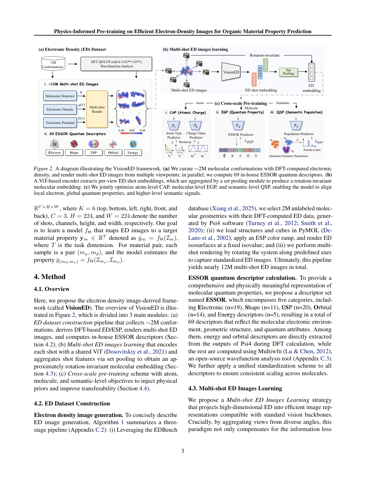

图源：用户项目中N17原文PDF，第3页。整页保留上下文，HTML中点击可放大；这是原文页面，不是本资料重绘的结果。

## 17 / L03　GPWNO：同时表示核附近细节与长程平滑密度

**原文标题：** Gaussian Plane-Wave Neural Operator for Electron Density Estimation

**年份与来源：** 2024；ICML 2024，PMLR 235。

**先补这些章节：** [15](#b15) 傅里叶与网格；[16](#b16) 周期边界；[23](#b23) 等变；[24](#b24) 神经算子。

### 先定位这篇的任务

字段 | 原文支持的结论
--- | ---
模型 | GPWNO：TFN初始化，组合Gaussian-type orbital支路和plane-wave/Fourier neural operator支路。
输入形式 | 原子三维坐标X、原子特征A、晶胞L及查询点Q；非周期分子用较大晶胞和零填充边界处理。
编码方式 | TFN将几何转成等变原子特征；GTO用径向基×球谐描述高频，PW支路经规则探针网格和FFT描述低频，二者相加重建ρ。
下游任务 | 论文中已实验评估：QM9、MD和周期材料数据上的电子密度估计。潜在用途：电子结构计算；交换相关能误差尚待验证。

**总体数据流：** 原子结构、晶格与查询点 → 高斯支路加平面波算子支路 → 连续空间电子密度。

### 为什么作者要做这个研究

电子密度有两种不同尺度：原子核附近变化很快，远处或大范围区域变化较平滑。单一表示可能顾此失彼。GPWNO借鉴量化计算的高斯和平面波思路，让两个神经分支分别承担不同尺度的信息。

### 两条支路在分工，而不是两套DFT

GPWNO最终预测ρ(r)，不会在神经网络内部先跑一次完整高斯DFT再跑一次平面波DFT。Gaussian和Plane-Wave是对输出函数与信息传播的设计启发。

先用TFN等变特征描述原子环境。高斯支路预测局部径向×球谐基系数，擅长核附近快速变化；平面波支路把原子信息传播到规则探针网格，再在傅里叶空间更新信号，擅长较长尺度变化。最后把两者结合，得到查询位置的密度。

### 用一个有尖峰的函数理解它

设一维目标有一个窄尖峰叠在宽背景上。只保留少量低频傅里叶分量会使尖峰变钝；用一个合适高斯放在尖峰处很有效。但若背景横跨很大范围，让所有局部高斯去协调它可能不经济。混合表示是把两类表达优势结合。

真实电子密度还存在角向结构、多原子影响与周期条件，因此上述例子只说明分工。论文用掩码等设计引导支路处理核附近区域，不能理解成把空间完全硬切成“这一半只归高斯、那一半只归平面波”。

### 晶胞与查询点为什么是输入的一部分

同样几组原子坐标放在不同周期盒中，镜像邻居可能不同，密度也会变。晶格L决定边界；查询位置Q告诉模型在哪评价。规则探针负责内部传播，不必与最终所有查询点完全相同。

神经算子强调函数映射，但实现仍有频率截断、探针分辨率和有限网络容量。换成更密网格不自动恢复训练时没学到的细节，也会增加评价成本。

### 如何读密度成绩

Table 1中QM9从InfGCN的0.93%到GPWNO的0.73%，是本文测试口径下的比较。ELECTRA后来也报告QM9分数，但测试数、对比来源与硬件不同，不能把两文所有数字直接排成完全公平榜单。

结论把交换关联能误差评价留待以后，因此当前证据支持密度估计，不能替它补写已经验证能量、SCF收敛、结合亲和力或药效。

**自测1：更低密度误差一定更低总能量误差吗？** 不保证。**自测2：连续查询是否零成本增加点数？** 不是。**自测3：为什么大MP数据难在本机完整复现？** 数据量、网格与训练预算远超过一个小算例，需要单独规划。

### 回到原文的方法步骤

**步骤1 / 高斯分支描述局部细节：** 用张量场网络提取等变原子特征，并预测高斯径向函数与球谐函数组合的系数。这类基函数集中在原子附近，适合表达尖锐局部变化。

**步骤2 / 平面波分支描述长尺度变化：** 将原子信息聚合到规则探针格点，在傅里叶空间通过神经算子传播，再聚合到查询点。这个分支擅长表达大范围、低频的变化。

**步骤3 / 融合并处理边界：** 把两支密度相加，并用核附近掩码引导分工。晶格用于处理周期边界；非周期分子则采用较大的零填充盒子。模型学习的是从结构到密度函数的映射，可以在查询位置求值。

### 数据集分别用在哪里

名称 / 描述 | 用途 | 规模或划分 | 要特别注意
--- | --- | --- | ---
QM9 density dataset | 非周期分子密度预测 | Appendix D列训练/验证/测试123,835 / 50 / 1,600 | VASP/PBE/PAW密度；按本文列出的划分，不套用ELECTRA的10,000测试。
MD dataset | 构象密度预测 | 乙醇、苯、苯酚、间苯二酚、乙烷、丙二醛 | 原文说明无独立验证集；Table 4列训练1,000（2,000）/测试500（400），括号对应差异未在该表逐分子展开。
Materials Project (MP) | 周期密度预测 | 来源117,535个结构；七晶系分别划分，Mixed为14,000/1,050/1,050 | 包括三斜、单斜、正交、四方、三方、六方、立方。各晶系完整划分见Table 5截图。
Cubic2 | 附录额外验证 | 14,421 / 1,000 / 1,000训练/验证/测试 | 与MP立方类结构有重叠，因此不作为完全独立的组成泛化证据。

原文一处将MP结构称为molecules，本表按材料语境记录为晶体结构。

### 结果怎样读

论文实验 | 作者报告的结果 | 适用口径
--- | --- | ---
QM9 NMAE | 0.93% → 0.73% | InfGCN与GPWNO；论文Table 1
苯构象 NMAE | 5.11% → 2.45% | 同一论文和相应测试设置
结构与边界消融 | 两支及周期处理均有作用 | 说明收益与表示分工及边界设计有关

这篇强调表示的互补性：不能只靠更多局部基函数，也不能只靠有限分辨率的规则网格。将局部高频和全局低频分开处理，有助于应对分子和晶体中不同尺度的密度变化。

### 局限与不能直接推出的结论

表中误差是相对该论文基线和数据的结果，不是跨年份的统一排名。论文把交换关联能误差的系统评价留待后续，因而密度误差改善不能直接转写成能量、DFT收敛或药物设计已经改善。网格与傅里叶计算的成本也随空间范围和分辨率变化。

### 在综述里怎样串起来

适合与ELECTRA、eqDeepDFT比较三种结构到密度路线：混合基函数、浮动高斯、查询点消息传递。对晶体任务，还应专门比较周期边界与晶格的处理方式。

### 原文证据与阅读定位

原文PDF第3–5页：§4方法；第6–8页：结果、消融和§6结论；第12页Fig.6：较完整网络架构。

**模型短引：** “Gaussian plane-wave neural operator”；PDF页序第1页，Abstract；§4。这段支持上面的模型说明；完整上下文请回原文。

**编码方式短引：** “plane-wave basis”；PDF页序第4页，§4.1 Overview及§4.2。这段支持上面的编码方式说明；完整上下文请回原文。

[打开本地原文PDF](../../03_%E5%8E%9F%E5%A7%8B%E6%96%87%E7%8C%AE/L03.pdf#page=5)；[打开已有黄色高亮标注版](../../02_%E8%AE%BA%E6%96%87%E9%98%85%E8%AF%BB%E6%88%90%E6%9E%9C/%E9%98%85%E8%AF%BB%E4%BA%BA2_%E8%AE%BA%E6%96%87%E6%95%B4%E7%90%86/%E5%8E%9F%E6%96%87%E6%A0%87%E6%B3%A8/L03_%E5%8E%9F%E6%96%87%E6%A0%87%E6%B3%A8.pdf)；[原文/出版社入口](https://raw.githubusercontent.com/mlresearch/v235/main/assets/kim24b/kim24b.pdf)。

**作者代码相关入口：** [查看仓库](https://github.com/seongsukim-ml/GPWNO)。需另核对对应版本、数据与权重。

仓库说明依据原文及项目历史核对记录；本次没有重新验证所有仓库的当前可运行性，也没有下载大型数据或训练模型。

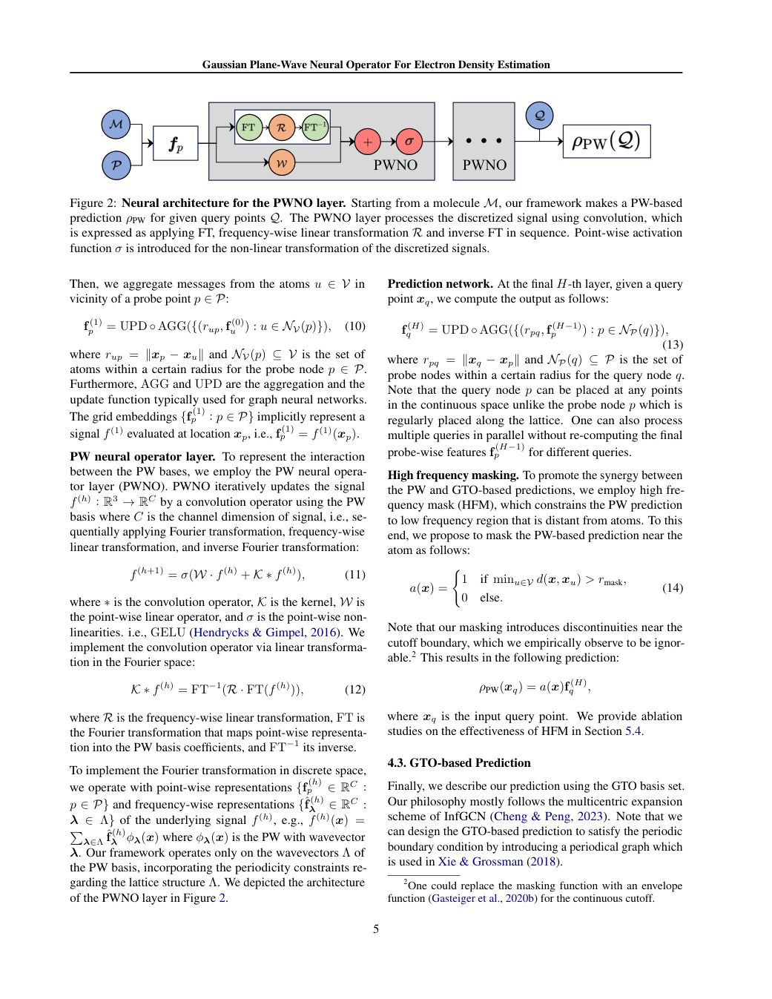

图源：用户项目中L03原文PDF，第5页。整页保留上下文，HTML中点击可放大；这是原文页面，不是本资料重绘的结果。

## 18 / L23　ML-HK：用机器学习替代部分Kohn-Sham求解

**原文标题：** Bypassing the Kohn–Sham Equations with Machine Learning

**年份与来源：** 2017；Nature Communications 8, 872。

**先补这些章节：** [12](#b12)–[13](#b13) HK/KS；[15](#b15) 密度展开；[20](#b20) 核回归。

### 先定位这篇的任务

字段 | 原文支持的结论
--- | ---
模型 | ML-HK：多组高斯核岭回归KRR学习势→密度展开系数，再学习密度→总能量；并与ML-KS、ML-OF比较。
输入形式 | 分子核电荷Z和原子坐标R构造的外势代理；1D演示则输入人工势函数。
编码方式 | 把原子中心高斯叠加势离散成网格并展平向量；回归密度的3D Fourier系数。1D还比较原始网格和KPCA基。
下游任务 | 论文中已实验评估：分子电子密度和总能量预测、构型能量面及丙二醛分子动力学/质子转移相关能量分析。

**总体数据流：** 由核位置构造外势表示 → 核回归预测密度系数 → 密度再映射为总能量。

### 为什么作者要做这个研究

早期机器学习密度泛函可以拟合能量，却可能因为导数不准而难以稳定最小化。本文提出另一条路线：先直接学习外部势与基态密度之间的映射，再学习密度与总能量之间的关系，在特定体系中绕开显式Kohn-Sham求解。

### 先理解作者避开了什么麻烦

一条路线是学习能量泛函，再靠泛函导数最小化找密度。但机器学习可能把能量高度拟合得很好，导数方向仍不可靠。作者改为先学外势到密度的Hohenberg–Kohn映射，再利用密度预测能量，减少对这个困难导数优化过程的依赖。

因此“bypassing”指在所研究任务中用训练好的映射替代显式KS求解，并不是发现了一个对任何分子都无需参考量化数据的公式。训练标签依然来自相应物理求解。

### 从坐标到最终能量的四步

第一步，根据核电荷与位置叠加平滑高斯，形成外势代理。真实核库仑势在核处奇异，不利于直接计算输入相似度；平滑代理用于表示，不能说作者把实际物理Hamiltonian改成了高斯核。

第二步，把代理在网格上采样并展平。第三步，KRR预测密度展开系数，三维实验主要用傅里叶表示，再重建ρ。第四步，学习密度与能量的映射。每个输出系数可以有对应核超参数，核方法在样本相似度上完成预测。

### 为什么物理中间量可能有帮助

直接从结构表示回归能量是一种路线，经密度中转是另一种路线。密度可以提供更平滑或受结构约束的中间表示，但是否帮助学习必须看比较实验，而不能只凭“密度重要”就断言。

一维模型还能与高精度真值和不同密度表示比较，适合验证思路；三维分子的对齐、表示维度和计算规模更困难。不要把一维漂亮结果当作化学空间通用能力。

### 分子动力学部分证明到哪

论文对苯、乙烷、丙二醛等构象与能量展开实验，丙二醛还涉及质子转移。文中短轨迹与有限差分力演示说明一定范围的可行性；极端构象出现更大误差提醒我们，长期稳定性和分布外结构不能省略检验。

**自测1：输入直接是精确外势吗？** 三维分子表示用平滑高斯代理。**自测2：预测密度后自动有全部KS轨道吗？** 没有。**自测3：能否用一套仅在水附近训练的KRR直接处理任意蛋白？** 本文没有这种证据。

### 回到原文的方法步骤

**步骤1 / 构造输入外势：** 根据核电荷和位置构造平滑的高斯势代理，避免直接处理核附近的库仑奇点，再在网格上离散成向量。这个输入由几何得到，不是把真实势完整逐点精确输入。

**步骤2 / 学习密度系数：** 用高斯核的核岭回归学习外势到密度的映射，密度可以用网格、傅里叶基或非线性低维表示展开。三维实验使用傅里叶表示，逐个学习展开系数，基截断也提供平滑约束。

**步骤3 / 利用密度预测能量：** 再学习密度到能量的映射，并与直接外势到能量、学习无轨道泛函等路线比较。论文考察“把密度作为中间变量”能否帮助学习与外推。

### 数据集分别用在哪里

名称 / 描述 | 用途 | 规模或划分 | 要特别注意
--- | --- | --- | ---
1D data set（沿用模型数据） | 概念验证 | 原文沿用Snyder等的一维势/密度数据；采用不同训练量M | 不是QM9，也不将空间网格点数当训练结构数。
H₂ geometries（作者构建，描述） | 分子验证 | 150个几何；100个候选训练池、50个测试 | 从100个候选中再选不同M训练；M不等于总候选池。
H₂O geometries（作者构建，描述） | 分子验证 | 350个几何；300个候选训练池、50个测试 | 变化键长与键角，通过K-means选训练子集。
MD data sets（作者构建的苯/乙烷/丙二醛构象） | 构象及动力学相关验证 | 苯示例2,000个代表训练几何，独立300 K轨迹取200个测试快照 | GAFF/PINY_MD采样后补PBE/PAW量化标签；不同分子和温度组合分开比较。

所有数据的公开入口见原文Data availability（quantum-machine.org/datasets）。这三种MD分子不等于后续论文的六分子扩展集。

### 结果怎样读

论文实验 | 作者报告的结果 | 适用口径
--- | --- | ---
丙二醛质子转移 | 能量MAE 0.27 kcal/mol | 对论文选定的转移构象测试
300 K模型轨迹 | 能量MAE 0.77 kcal/mol | 有限差分力驱动的短时间演示
极端构象 | 最大误差可达5.7 kcal/mol | 提示离开训练覆盖后的可靠性问题

这是一项早期概念验证：把Hohenberg-Kohn映射直接交给机器学习，并让密度充当结构与能量之间的物理中间量。在文中设置下，它能减少对显式电子结构求解的依赖，也显示密度表示具有平滑和正则化作用。

### 局限与不能直接推出的结论

模型不是对任意化学组成都可直接使用的通用替代器。全局输入和核方法的计算随训练集增大而增长，旋转、对齐和分布外构象也是挑战。论文的短轨迹不足以证明长期生产级分子动力学稳定性，密度预测也不会自动提供全部轨道信息。

### 在综述里怎样串起来

它可作为综述中“密度作为机器学习中间变量”的历史起点。与现代局部等变模型相比，主要差别在可迁移性、对称性和计算规模，而不只是发表年份早晚。

### 原文证据与阅读定位

原文PDF第2–4页：ML-HK的定义；第5–7页：分子与动力学测试；第8页：讨论；第9页Methods：参考计算与采样。

**模型短引：** “kernel ridge regression”；PDF页序第3页，Results中ML-HK推导；Methods p9。这段支持上面的模型说明；完整上下文请回原文。

**编码方式短引：** “flatten it into a vector”；PDF页序第4页，Eq.12下方；密度基比较p3。这段支持上面的编码方式说明；完整上下文请回原文。

[打开本地原文PDF](../../03_%E5%8E%9F%E5%A7%8B%E6%96%87%E7%8C%AE/L23.pdf#page=4)；[打开已有黄色高亮标注版](../../02_%E8%AE%BA%E6%96%87%E9%98%85%E8%AF%BB%E6%88%90%E6%9E%9C/%E9%98%85%E8%AF%BB%E4%BA%BA2_%E8%AE%BA%E6%96%87%E6%95%B4%E7%90%86/%E5%8E%9F%E6%96%87%E6%A0%87%E6%B3%A8/L23_%E5%8E%9F%E6%96%87%E6%A0%87%E6%B3%A8.pdf)；[原文/出版社入口](https://www.nature.com/articles/s41467-017-00839-3.pdf)。

**代码边界：** 未查得明确对应本文的作者完整官方GitHub；原文数据入口不等于源码。

仓库说明依据原文及项目历史核对记录；本次没有重新验证所有仓库的当前可运行性，也没有下载大型数据或训练模型。

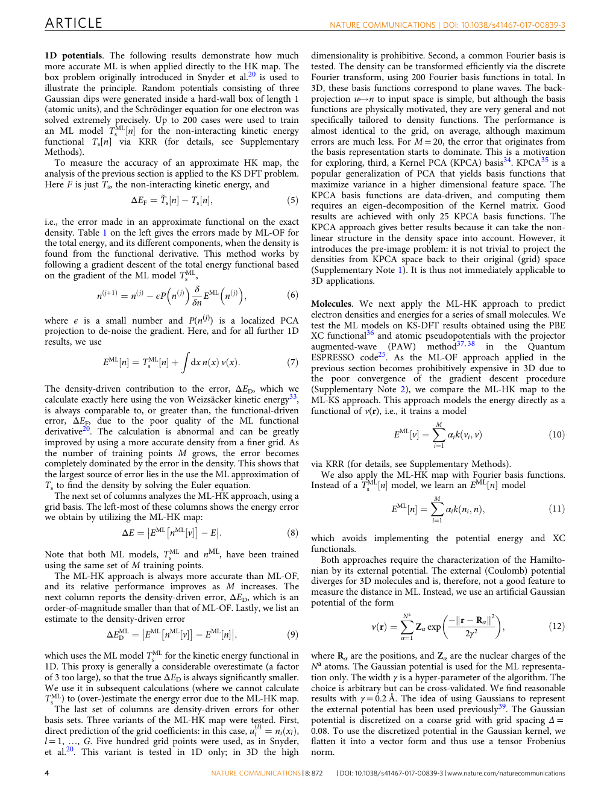

图源：用户项目中L23原文PDF，第4页。整页保留上下文，HTML中点击可放大；这是原文页面，不是本资料重绘的结果。

## 补充 / PPT-A　eqDeepDFT：通过空间探针预测密度

**原文标题：** Equivariant graph neural networks for fast electron density estimation of molecules, liquids, and solids

**来源：** 2022 · npj Computational Materials 8, 183。

**数据流：** 元素、坐标与晶胞 → 等变原子图加只接收消息的探针 → 查询位置的密度值。

### 把探针看成一个只提问、不改分子的观察者

原子节点先交换环境信息；某个查询探针从附近原子读取特征，输出这个位置的ρ。探针只接收、不把自己的状态反馈到原子，使查询位置的增减不必改变原子骨架的表示。它不是一个带核电荷的新原子。

等变版本把标量与方向型特征一起处理，让分子旋转时局部方向信息正确变化。与不变版本的比较是在检验“方向特征能否提高密度建模”，不是说标量密度本身要变成向量。

三类体系为QM9分子、液态碳酸乙烯酯和NMC正极晶体。它们检验相态和环境差异；液体快照包含多个分子，不等于每帧是一种新化合物。应用时还要检查参考密度、周期边界和点数带来的成本。

**与9篇连接：** 和ELECTRA相比，它在查询点直接读出，而不是先放浮动高斯；和GPWNO相比，没有相同的高斯/平面波双支路。这是表示路线差异，不代表一种路线在所有场景都更好。

**自测：** 把密度查询点移到分子外，模型在回答什么？回答新空间位置的场值，并没有生成一个新分子。

### 意义与局限

论文证明的是所测数据上的密度估计效果，未直接验证药物筛选。查询点方法灵活，但预测大量格点仍有成本。误差参考的是DFT标签，不能写成获得无误差的真实密度。

### 原文与现有材料

PPT第2–3页及讲者备注；原文Results、Table 1、Methods。

[本地原文PDF](../../03_%E5%8E%9F%E5%A7%8B%E6%96%87%E7%8C%AE/%E8%A1%A5%E5%85%85%E6%96%87%E7%8C%AE_%E6%95%B0%E6%8D%AE%E9%9B%86%E6%A0%B8%E5%AF%B9/PPT-A.pdf)；[出版社入口](https://doi.org/10.1038/s41524-022-00863-y)。

## 补充 / PPT-B　QTAIM-embed：将密度特征加入分子图

**原文标题：** High-throughput quantum theory of atoms in molecules (QTAIM) for geometric deep learning of molecular and reaction properties

**来源：** 2024 · Digital Discovery 3, 987–998。

**数据流：** DFT密度 → QTAIM关键点与图特征 → 分子和反应性质。

### 连续场先变成摘要，再交给图模型

generator流程计算/读取量化电子结构，再用Multiwfn或critic2提取QTAIM信息，整理原子、键及全局特征，交给几何图网络学习性质。generator和qtaim_embed是流水线与建模中的相关组成，不要把一份特征文件当作完整训练框架。

相较于整块密度，拓扑摘要更紧凑且容易接到分子图。但摘要会丢失信息，提取本身也有计算成本。问“QTAIM是否有效”，必须说清用于哪个任务、哪类特征、哪个基线与什么划分。

文章涉及QM8、QM9、LIBE、Tox21和Green 2022反应数据；不是这些任务都同样改善。LIBE形成能的一个对比从76.26降到45.09 meV/atom，说明该实验有收益，不能推广成所有性质都更准。

**与9篇连接：** L25先学完整密度再分析，本文先从密度提特征再学性质；VisionED把电子信息压成图像，这里压成图上的数值。三者压缩位置与丢失信息不同。

**自测：** 模型推理很快能代表整条流程便宜吗？如果新分子仍需DFT和QTAIM提取，就必须把这些成本计入。

### 意义与局限

它把连续场压缩成可供图模型使用的数值特征。使用前仍需获取量化密度，必须把特征成本纳入评价。文中结果不能概括成“所有性质都因QTAIM改善”。

### 原文与现有材料

PPT第2–3页及讲者备注；原文§1、§3与§4（LIBE结果）。

[本地原文PDF](../../03_%E5%8E%9F%E5%A7%8B%E6%96%87%E7%8C%AE/%E8%A1%A5%E5%85%85%E6%96%87%E7%8C%AE_%E6%95%B0%E6%8D%AE%E9%9B%86%E6%A0%B8%E5%AF%B9/PPT-B.pdf)；[出版社入口](https://doi.org/10.1039/d4dd00057a)。

[作者仓库相关入口](https://github.com/santi921/qtaim_embed)。本次未宣称完成代码复现。

## 补充 / PPT-C　BCP/NCP图：密度信息能否改善结合亲和力？

**原文标题：** Exploring protein-ligand binding affinity prediction with electron density-based geometric deep learning

**来源：** 2024 · RSC Advances 14, 4492–4502。

**数据流：** 复合物与GFN2-xTB密度 → BCP/NCP相互作用图 → 结合亲和力预测。

### 这篇必须保留“没有超过基线”的结果

作者从蛋白–配体复合物的GFN2-xTB电子结构提取QTAIM信息，再构建密度衍生图。BCP图以临界点作节点；NCP表示用相应核位置及BCP相关特征组织图。图节点不是普通分子图的同一套定义，不能只写“用了GNN”。

任务是亲和力回归，数据含PDBbind与PDE10A，比较随机与更难的划分。论文结论是所测方案未超过已有方法，在部分PDE10A非随机划分上甚至不及均值预测。负面结果对研究问题同样重要。

一种合理解释是所加信息可能与结构冗余，或近似密度、图压缩、样本量与缺少自由能因素限制了收益；这些是讨论中的可能因素，不能从实验里单独锁定唯一原因。

**与9篇连接：** 密度预测好并不直接证明能改进亲和力。ELECTRA和GPWNO的主表不能替这篇的下游评测；反过来，这篇失败也不能证明电子密度对所有学习任务都没用。

**自测：** 接下来研究该怎样推进？可比较结构基线、加电子特征、相同预算与相同划分，并分析信息增量和计算成本；这是本资料提出的研究建议，不是论文已完成的新实验。

### 意义与局限

这是综述需要保留的负面证据：增加量子特征不保证收益。作者讨论了近似密度、已有结构信息以及熵等可能原因，不能据此宣称密度对所有结合任务均无用。

### 原文与现有材料

PPT第2–3页及讲者备注；原文QM & QTAIM calculations、graph representations、Results与Conclusions。

[出版社入口](https://doi.org/10.1039/d3ra08650j)。

## 补充 / PPT-D　ED2Mol：以预测密度指导片段生长

**原文标题：** Electron-density-informed effective and reliable de novo molecular design and optimization with ED2Mol

**来源：** 2025 · Nature Machine Intelligence 7, 1355–1368。

**数据流：** 口袋结构与密度场 → 预测配体场并组装片段 → 分子设计与命中物优化。

### 密度先提供空间方向，片段再落实化学结构

ED2Mol把口袋条件下的配体场预测与片段生长连接。先定位核心，再逐步选生长位置、片段与取向/扭转角，密度引导在哪些区域布置原子。给定参考核心也可用于优化。场提供约束，片段库和生长规则承担部分化学有效性。

这套场定义、数据处理和渲染/密度参数必须按原文与作者代码理解，不能直接拿任意DFT cube或实验2Fo−Fc图替换后默认兼容。名称里同样有ED，不代表它与L11拥有相同条件输入与网络模块。

论文报告了计算物理有效性及针对部分候选的湿实验，涉及FGFR3、CDC42、GCK、GPRC5A等；部分结合模式还有晶体学支持。必须区分“生成池中的有效结构比例”“被选中送测的分子数”和“测到活性的数量”。>97%的物理可靠性不是97%的生物活性命中率。

**材料边界：** 本次可核对的来源为出版社摘要/图说明、作者仓库与本地补充信息PDF；未取得可自由读取的完整主文，故不编造主文页码、每个靶点的精确测定值或完整复现实验。

**自测：** 为什么湿实验验证比对接分数更接近实际活性证据？它对实际样品测量特定生物学量；但测定类型、候选选择和重复性仍限定结论。

### 意义与局限

它把密度指导延伸到有实验验证的完整设计流程。论文的“>97%物理可靠性”不能当作活性命中率；效果还依赖片段库、筛选与候选选择。密度场也不能直接视为精确DFT电子数密度。

### 原文与现有材料

PPT第2–3页；出版社摘要与Figs.1–6；作者仓库Generate.py、ED_Generator.py。正文受访问限制，本节据可访问的一手材料概括。

[本地补充信息PDF](../../03_%E5%8E%9F%E5%A7%8B%E6%96%87%E7%8C%AE/%E8%A1%A5%E5%85%85%E6%96%87%E7%8C%AE_%E6%95%B0%E6%8D%AE%E9%9B%86%E6%A0%B8%E5%AF%B9/PPT-D-SI.pdf)；[出版社入口](https://doi.org/10.1038/s42256-025-01095-7)。

[作者仓库相关入口](https://github.com/pineappleK/ED2Mol)。本次未宣称完成代码复现。

## 横向比较：把13篇放到正确位置

下表比较的是任务位置，不是性能排行榜。跨论文的误差、数据标签、划分与硬件不统一，因此不能简单按一个百分数排出“最强”。

论文 | 密度的角色 | 真正预测/计算什么 | 主要证据层级
--- | --- | --- | ---
N21 ELECTRA | 输出与SCF初猜 | 高斯密度参数 → 空间密度 | 密度基准＋SCF迭代实验
N04 ∇²DFT | 电子结构背景/可衍生对象 | 多模型的矩阵、能量、力、优化 | 数据集＋计算基准
L11 | 条件与生成中间场 | 口袋 → 配体密度 → 分子 | 生成与计算评价
N08 xTB | 近似电子结构中的量 | 几何、频率、电子结构等 | 方法综述与多种评测
L25 SA-GPR | 输出 | 局部密度展开系数 | 密度＋非共价衍生分析＋迁移
N03 EG-XC | SCF中间输入 | 交换关联能近似 | 能量/势能面/外推实验
N17 VisionED | 图像输入的来源 | 光伏与光学性质 | 预训练＋下游性质基准
L03 GPWNO | 输出 | 局部＋长尺度密度 | 分子与晶体密度基准
L23 ML-HK | 中间输出 | 势 → 密度 → 能量 | 一维/分子/短轨迹演示
PPT-A eqDeepDFT | 输出 | 空间查询点密度 | 分子/液体/固体密度
PPT-B QTAIM-embed | 特征来源 | 分子与反应性质 | 多任务特征比较
PPT-C BCP/NCP | 特征来源 | 结合亲和力 | 含未超过基线的结果
PPT-D ED2Mol | 生成引导场 | 分子生成与优化 | 计算指标＋部分候选湿实验

### 可以怎样写一段综述

“现有研究可以按密度在流程中的角色组织。结构到密度方法以局部等变表示、连续查询或混合基函数降低场预测成本；泛函学习将网络嵌入自洽求解；表示学习把密度压缩为图像或拓扑特征；生成方法将空间场作为分子构建的条件。这些路线在密度精度、计算成本和下游证据上并不等价。亲和力负面结果说明，加入电子信息是否有效仍需按任务验证。”

这段是本资料的综合归纳，不是任何一篇原文的直接引语。具体数字与成功结论应紧跟各自来源及实验条件。

### 两个可以在本机继续的小研究问题

一是对同一水分子或小分子，在相同网格比较不同方法的密度、电子数积分及衍生量，先建立可靠数据处理。二是比较同等数据划分下的结构基线与加入电子特征的模型，量化信息增量与成本。两者是学习/研究建议，不是这13篇已完成的新结果。

## 实践：从真实输出理解抽象概念

本节是本机新运行的教学计算，不是论文复现。使用已安装的WSL / PySCF 2.14.0，4个CPU线程；水为固定中性闭壳层单重态，O(0,0,0)，H(0,−0.757,0.587)，H(0,0.757,0.587)，坐标单位Å。没有对这份几何做优化。

### 1 看见基组改变了什么

HF使用STO-3G与def2-SVP。两次都是10电子，但AO基函数分别7个与24个。观察密度图时使用相同坐标与色标；图显示x=0平面，颜色为log10密度，展示范围为−5到1.7，超出范围的值饱和显示，不用于读取核处最大值。

方法 / 基组 | AO数 | 总能量 / hartree | 积分电子数 | SCF
--- | --- | --- | --- | ---
HF_STO3G | 7 | -74.9630631297 | 10.00000012 | 收敛
HF_def2SVP | 24 | -75.9609751670 | 10.00000006 | 收敛
LDA_def2SVP | 24 | -75.7951907224 | 10.00000006 | 收敛
PBE_def2SVP | 24 | -76.2720144727 | 10.00000006 | 收敛
B3LYP_def2SVP | 24 | -76.3581494547 | 10.00000006 | 收敛

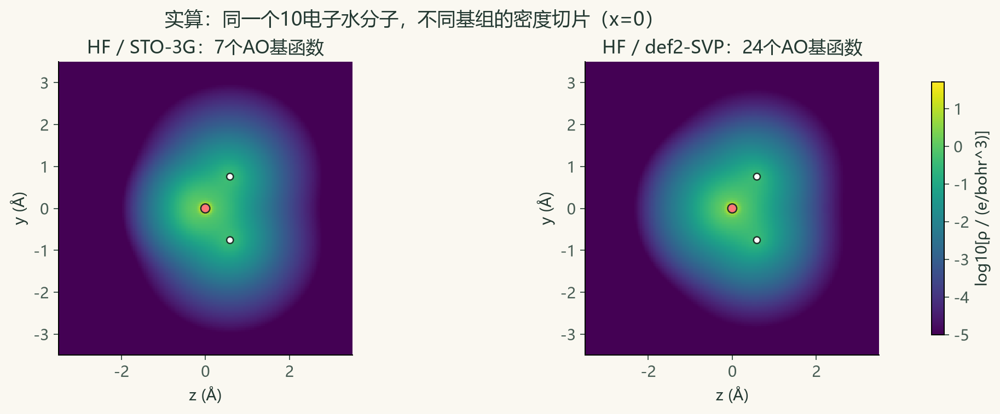

**怎样读：** 两个图的总体形状由同一分子骨架决定；数值和细节因近似表示而变。积分都接近10，说明这里“改变基组”没有改变电子数。def2-SVP结果能量更低是本例观察，不能用不同泛函的绝对能量负值大小判断精度。

### 2 观察SCF怎样收敛，比较两种泛函的密度

水的LDA(lda,vwn)、PBE、B3LYP使用同一def2-SVP基组、同一几何与查询平面；SCF能量容差1e−10 hartree，DFT积分网格level=3。电子数单独用level=4原子中心数值积分网格检查。图里的二维切片不是积分出10个电子所用的整个三维网格。

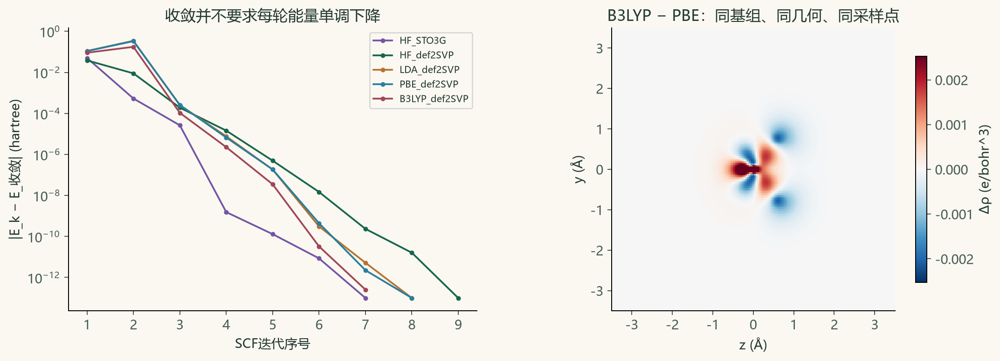

左图以每步能量与最终收敛能量的绝对差作纵轴，使用对数尺度；为绘图将极小值截在1e−13。某步能量上升不必然意味着失败，关键是最终收敛及所用判据。右图只反映两个近似密度的差，不是任何一个与精确真值的误差。红蓝数值范围按绝对差的99.8%分位设置，极少数更大值以端点颜色显示。

### 3 看见差分密度的正和负

二聚体使用两份冻结水几何，O−O距离2.9 Å，PBE/def2-SVP。两个单体各自保留对方位置的ghost基函数，因此在相同48个AO基函数空间中计算；ghost提供基函数而不提供核电荷或电子。ρAB有20电子，两个参照各10电子。

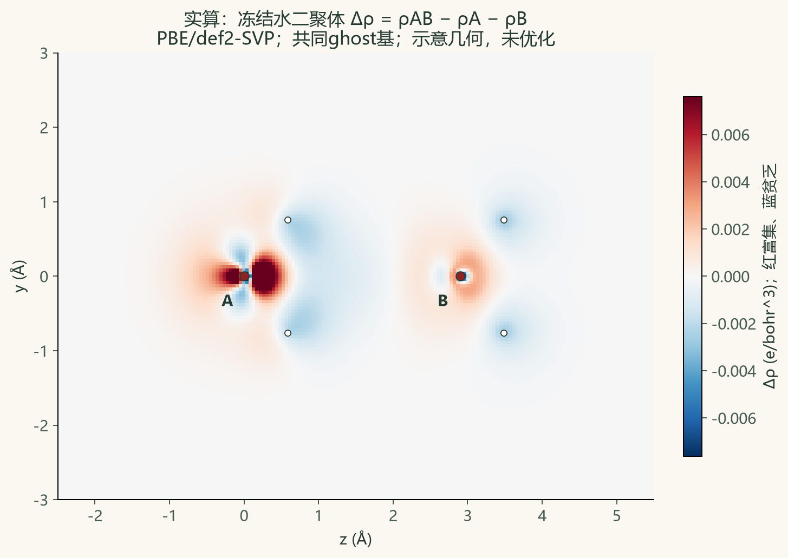

红色表示相对冻结单体参照的电子富集，蓝色表示贫乏。图按绝对差99.7%分位选择对称色标，超出范围饱和显示。几何只用于说明，不是优化后的二聚体，不据此报告最佳氢键强度、结合自由能或实验结论。

在无数值积分误差的全空间中，电子数守恒给出∫Δρ=20−10−10=0。**本次并未对二聚体差分场另做全空间数值积分检验**；这里只输出同平面的差分数组，不能拿切片的面积积分代替三维体积积分。

### 4 用教学函数理解高斯与傅里叶

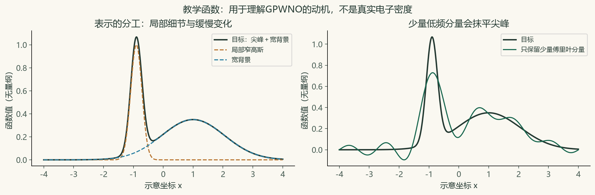

这是人为构造的无量纲函数。尖峰由窄高斯形成，背景平滑而宽；少量低频傅里叶分量抓得到背景，却会抹平尖峰。它说明GPWNO的表示动机，不是实际实现的消融，也不是量化计算结果。

### 5 凭记忆画出SCF

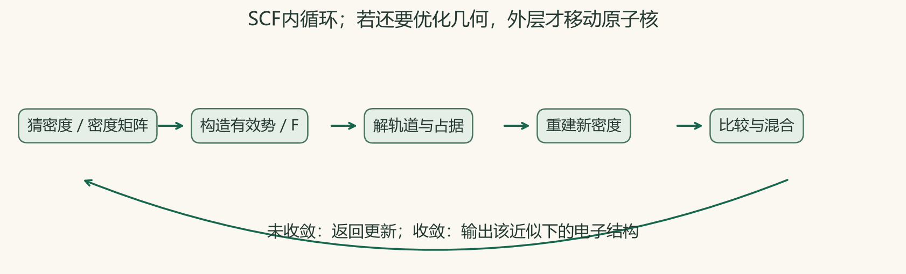

遮住图，自己说出“猜密度—建F—解轨道—更新密度—检查/混合”。再在外层加上“计算力—移动核—下一几何”，就能分清电子SCF与几何优化。

### 保存了什么、怎样重跑

[teaching_results.json](实践/teaching_results.json)保存方法、基组、电子数、能量与每步SCF历史；[teaching_density_arrays.npz](实践/teaching_density_arrays.npz)保存坐标轴和密度/差分数组，密度单位为e/bohr³、坐标轴为Å。[教学计算脚本](实践/run_teaching.py)可放在本机已有qc环境运行，输出到脚本所在目录。

在PowerShell中可调用已有环境：

`wsl.exe -d Ubuntu -- /home/doubao/edensity-tools/mamba/envs/qc/bin/python /mnt/d/电子密度综述/04_学习资料/电子密度_前置知识与论文精读_20261105/实践/run_teaching.py`

系统Python与WSL中的qc Python是不同环境；若换电脑，先按[PySCF官方安装说明](https://pyscf.org/user/install.html)准备可用环境，再运行。不要把这里几秒的小计算耗时外推到大型模型训练。

## 随查术语表

释义用于快速回忆；不替代前文解释。编号对应前置章节或论文编号。

英文 | 中文 | 一句话含义 | 回看
--- | --- | --- | ---
electron density | 电子密度 | 空间电子数分布，整体积分为N | 04、06
wavefunction | 波函数 | 多电子联合量子态的描述 | 06
orbital | 轨道 | 单电子状态/展开对象，不是运动路线 | 08–09
basis set | 基组 | 表达轨道或场的一组函数 | 09
auxiliary basis | 辅助基 | 拟合密度等对象，区别于轨道基 | 09、L25
density matrix | 密度矩阵 | 特定基底下用于重建密度的矩阵 | 10
overlap matrix | 重叠矩阵 | 记录基函数的非正交重叠 | 10
Fock matrix | Fock矩阵 | 有效单电子方程的基底表示 | 10
SCF | 自洽场 | 反复更新使电子分布与所建场一致 | 11
HF | 哈特里–福克 | 含交换的单行列式平均场近似 | 08、11
DFT | 密度泛函理论 | 以密度组织基态电子结构问题 | 12
HK theorem | HK定理 | 说明基态密度与外势/能量的关系 | 12
KS equations | KS方程 | 辅助非相互作用体系的求解方程 | 13
functional | 泛函 | 以函数为输入的规则 | 12
functional derivative | 泛函导数 | 能量对局部密度改变的响应 | 13
exchange-correlation | 交换关联 | 超出相应辅助与经典项的剩余贡献 | 12–14
LDA/GGA/meta-GGA | 半局域近似层级 | 逐步加入梯度、动能密度等信息 | 14
hybrid functional | 杂化泛函 | 混入HF型交换的泛函近似 | 14
Gaussian | 高斯函数 | 局部集中的指数型数学构件 | 09、15
plane wave | 平面波 | 遍布空间的周期波函数基 | 15
Fourier transform | 傅里叶变换 | 在空间与频率表示间转换 | 15
spherical harmonics | 球谐函数 | 描述角向形状的基 | 16
PBC | 周期边界 | 按晶格重复体系 | 16
query point | 查询点 | 要评价场值的空间位置 | 03、22
voxel | 体素 | 三维网格单元 | 15、L11
isosurface | 等值面 | 场值等于指定阈值的表面 | 17
ESP | 静电势 | 单位正试探电荷所感受到的势 | 17
difference density | 差分密度 | 相对指定参照的电子重排 | 17
structure factor | 结构因子 | 衍射中的复数量 | 18
phase problem | 相位问题 | 强度测量不能直接给出重建所需相位 | 18
2Fo−Fc | 实验模型加权图 | 有分辨率/标度/模型影响的空间图 | 18
dispersion | 色散 | 电子涨落相关带来的作用 | 19
QTAIM | 分子中原子量子理论 | 根据密度梯度拓扑分区和分析 | 19
BCP/NCP | 键/核临界点 | 特定梯度和Hessian性质的位置 | 19
KRR | 核岭回归 | 按样本相似度正则化回归 | 20
SA-GPR | 对称性适配高斯过程回归 | 处理输出旋转规律的局部核学习 | L25
regularization | 正则化 | 约束模型复杂度以改善泛化 | 20
GNN | 图神经网络 | 节点边上的特征更新 | 22
message passing | 消息传递 | 邻居特征聚合与更新 | 22
invariance | 不变性 | 变换后输出标量不改变 | 23
equivariance | 等变性 | 输入与输出按匹配规则变换 | 23
neural operator | 神经算子 | 学习函数间映射的模型 | 24
ViT | 视觉Transformer | 把图像块编码并聚合 | 24、N17
GAN | 生成对抗网络 | 生成器与判别器对抗学习 | 24
VQ-VAE | 向量量化变分自编码器 | 使用离散码本的潜表示模型 | 24
PixelCNN | 自回归图像/码模型 | 按顺序条件生成位置内容 | 24
diffusion model | 扩散模型 | 学习逐步去噪的生成过程 | 24
pre-training | 预训练 | 先用较大数据学习表示 | 21、N17
fine-tuning | 微调 | 在特定任务上继续调整参数 | 21
OOD | 分布外 | 训练覆盖以外的温度/结构等 | 25
scaffold split | 骨架划分 | 用不同骨架隔开集合 | 21
data leakage | 数据泄漏 | 评估中间接用了测试信息 | 21
MAE/RMSE | 误差指标 | 平均绝对/均方根误差 | 25
NMAE | 归一化绝对误差 | 归一化方式必须回查原文 | 25
ablation | 消融 | 移除组件检验其作用 | 25
binding affinity | 结合亲和力 | 与结合平衡及自由能有关 | 26
validity | 有效性 | 需查看具体化学/几何判据 | 25
checkpoint | 模型检查点 | 保存的已训练参数等状态 | 27

## 闭卷自测：先尝试解释，再展开答案

不以背数字为目标。每题能说出原因与一个例子，才算理解。无法解释时，返回所列章节。

### 第01题　XYZ坐标直接给出电子密度吗？

**参考答案：** 没有，只给核骨架；还需电子态、近似方法或学习模型。

**返回：** 02、06。

### 第02题　10电子水的ρ在某点为3，是否有3个电子挤在一点？

**参考答案：** 不是，3是有体积单位的密度；对区域积分才有电子数期望值。

**返回：** 04。

### 第03题　为什么把坐标换成Å时还要考虑密度单位？

**参考答案：** 密度随体积单位变换，体积按长度三次方变化。

**返回：** 04。

### 第04题　波函数正负与电子密度正负有什么差别？

**参考答案：** 波函数有相位，密度非负；差分密度可正可负。

**返回：** 06、17。

### 第05题　固定核算电子结构，与核永远不动是一回事吗？

**参考答案：** 不是，BO近似先在固定几何求电子，核可在势能面上运动。

**返回：** 07。

### 第06题　HF忽略全部电子排斥吗？

**参考答案：** 没有，它包含平均库仑和交换，缺少完整相关。

**返回：** 08。

### 第07题　AO基、辅助密度基、高斯场构件是一样的吗？

**参考答案：** 用途与数学对象不同，需在每篇中分别辨认。

**返回：** 09。

### 第08题　为什么电子数是Tr(PS)而非一般地Tr(P)？

**参考答案：** AO基非正交，重叠矩阵S必须计入。

**返回：** 10。

### 第09题　SCF收敛能证明泛函精确吗？

**参考答案：** 只能证明指定近似和数值条件下的自洽收敛。

**返回：** 11。

### 第10题　泛函和普通函数的输入有什么不同？

**参考答案：** 泛函接收整个函数，如E[ρ]接收密度分布。

**返回：** 12。

### 第11题　能量拟合好为什么仍可能导数差？

**参考答案：** 函数高度误差小仍可有局部快速振荡，斜率会偏差很大。

**返回：** 13。

### 第12题　杂化泛函能量更负就一定更准吗？

**参考答案：** 不同近似的绝对能量不能这样排序，要对目标量与参考比较。

**返回：** 14。

### 第13题　高频空间分量与高振动频率一样吗？

**参考答案：** 不同，一个指场的空间变化尺度，一个指核运动频率。

**返回：** 15。

### 第14题　为什么晶体预测需要晶格？

**参考答案：** 周期邻居及边界由晶格决定。

**返回：** 16。

### 第15题　ESP和ρ能用同一单位直接相减吗？

**参考答案：** 它们物理量和单位不同，不能这样减。

**返回：** 17。

### 第16题　差分密度负值表示负电子吗？

**参考答案：** 表示相对参照贫乏，不是负的电子数密度。

**返回：** 17。

### 第17题　2Fo−Fc每个值都是精确绝对电子数密度吗？

**参考答案：** 不是，图受分辨率、模型相位、处理与标度影响。

**返回：** 18。

### 第18题　有BCP就证明强稳定键吗？

**参考答案：** 不能单凭这个拓扑特征推出强度或自由能。

**返回：** 19。

### 第19题　KRR的核宽度越小越好吗？

**参考答案：** 不是，过小会只记近邻，需验证集选择并防过拟合。

**返回：** 20。

### 第20题　同一分子的网格点随机切分能证明新分子泛化吗？

**参考答案：** 不能，分子结构已经见过；要按目标在体系层面划分。

**返回：** 21。

### 第21题　消息传递的边必须是共价键吗？

**参考答案：** 不必须，三维模型常按空间距离建立边。

**返回：** 22。

### 第22题　把分子和查询点一起转动，密度值应怎样？

**参考答案：** 相同对应位置应得到相同标量值，整张场随分子旋转。

**返回：** 23。

### 第23题　六视图平均是不是严格SO(3)不变？

**参考答案：** 一般不保证，固定投影无法穷尽任意连续旋转。

**返回：** 23、N17。

### 第24题　L11使用扩散模型吗？

**参考答案：** 其主要组件是条件GAN、VQ-VAE2、PixelCNN及结构重建。

**返回：** L11。

### 第25题　ELECTRA预测的高斯个数等于电子数吗？

**参考答案：** 不是，高斯是表示构件；最终电子数需积分检查。

**返回：** N21。

### 第26题　EG-XC只有能量监督，是否输入没有密度？

**参考答案：** 不是，密度是SCF中间输入，监督目标是能量。

**返回：** N03。

### 第27题　∇²DFT有千万构象，是否就是千万分子？

**参考答案：** 不是，分子可有多个构象和轨迹帧。

**返回：** N04。

### 第28题　L25的8个多肽用来做什么？

**参考答案：** 考察从片段训练到更大体系的迁移。

**返回：** L25。

### 第29题　GPWNO的0.73%证明亲和力预测更好吗？

**参考答案：** 没有，它是对应设置下的密度误差。

**返回：** L03。

### 第30题　ML-HK用核坐标高斯代理，是把真实核势改成高斯了吗？

**参考答案：** 代理用于机器学习输入表示，不是重新定义参考物理Hamiltonian。

**返回：** L23。

### 第31题　xTB与GFN-FF都显式求同样的电子结构吗？

**参考答案：** 不是，GFN-FF是力场，要和xTB电子结构方法分开。

**返回：** N08。

### 第32题　QTAIM特征一定提高所有性质预测吗？

**参考答案：** 不一定，要看任务、成本、划分与比较基线。

**返回：** PPT-B、PPT-C。

### 第33题　ED2Mol物理有效性97%能写成活性命中率97%吗？

**参考答案：** 不能，几何/物理判据和湿实验活性是不同指标。

**返回：** PPT-D。

### 第34题　安装环境等于复现论文吗？

**参考答案：** 不等于；还需对应数据、配置、检查点、评价及结果比较。

**返回：** 27。

## 来源、证据和使用边界

前9篇主要依据本地原文PDF与已有的六字段证据、数据集证据记录重新组织。N08现在在“文献标注”中有49页扫描标注版，不能文本搜索；理论和实现仍可用出版社全文按小节定位。本次没有覆盖、改写或重新标注这些原件。

补充4篇属于先前汇报的延伸。eqDeepDFT与QTAIM-embed有本地PDF；亲和力论文使用可获得的一手正文与历史核对记录；ED2Mol未取得自由可读完整主文，以出版社摘要/图说明、仓库及补充信息为依据，其精确细节不冒充已完整审读。

短引只用来定位模型与编码术语，中文解释是本资料的转述。页码默认指PDF页序；L25额外封面会使它与期刊印刷页码相差一页。原文整页图片保留上下文，建议结合PDF放大阅读。外链可能随出版平台与仓库更新变化。

资料包离线包含所有讲解、图解、自测、实算脚本与数值结果。为避免重复复制大型原件，ZIP不包含论文原PDF；包内原文页面图片仍可离线看。移动文件夹后，指向原项目的相对PDF/旧证据链接可能失效，可用出版社入口查找。

### 之前的证据材料

- [阅读人2六字段总结与原文证据](../../02_%E8%AE%BA%E6%96%87%E9%98%85%E8%AF%BB%E6%88%90%E6%9E%9C/%E9%98%85%E8%AF%BB%E4%BA%BA2_%E8%AE%BA%E6%96%87%E6%95%B4%E7%90%86/%E9%98%85%E8%AF%BB%E4%BA%BA2_%E9%80%90%E7%AF%87%E6%80%BB%E7%BB%93%E4%B8%8E%E5%8E%9F%E6%96%87%E8%AF%81%E6%8D%AE.html)
- [数据集及原文证据图片](../../02_%E8%AE%BA%E6%96%87%E9%98%85%E8%AF%BB%E6%88%90%E6%9E%9C/%E6%95%B0%E6%8D%AE%E9%9B%86%E6%B1%87%E6%80%BB%E4%B8%8E%E5%8E%9F%E6%96%87%E8%AF%81%E6%8D%AE/%E6%89%93%E5%BC%80%E6%9F%A5%E7%9C%8B_%E6%95%B0%E6%8D%AE%E9%9B%86%E4%B8%8E%E8%AF%81%E6%8D%AE%E5%9B%BE.html)
- [已安装软件与启动说明](../../08_%E8%AE%A1%E7%AE%97%E7%8E%AF%E5%A2%83%E4%B8%8E%E5%90%AF%E5%8A%A8/%E4%BD%BF%E7%94%A8%E8%AF%B4%E6%98%8E.md)

### 一手资料补充入口

- [PySCF SCF方法](https://pyscf.org/user/scf.html)
- [PySCF DFT方法](https://pyscf.org/user/dft.html)
- [xTB综述全文](https://wires.onlinelibrary.wiley.com/doi/full/10.1002/wcms.1493)
- [GPWNO正式出版记录](https://proceedings.mlr.press/v235/kim24b.html)
- [VisionED正式出版记录](https://proceedings.mlr.press/v306/cheng26m.html)

本次整理日期：2026-11-05。教学计算与论文报告严格分开；未宣称训练或复现9篇模型。
